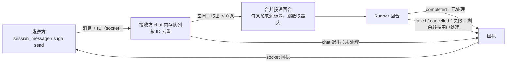
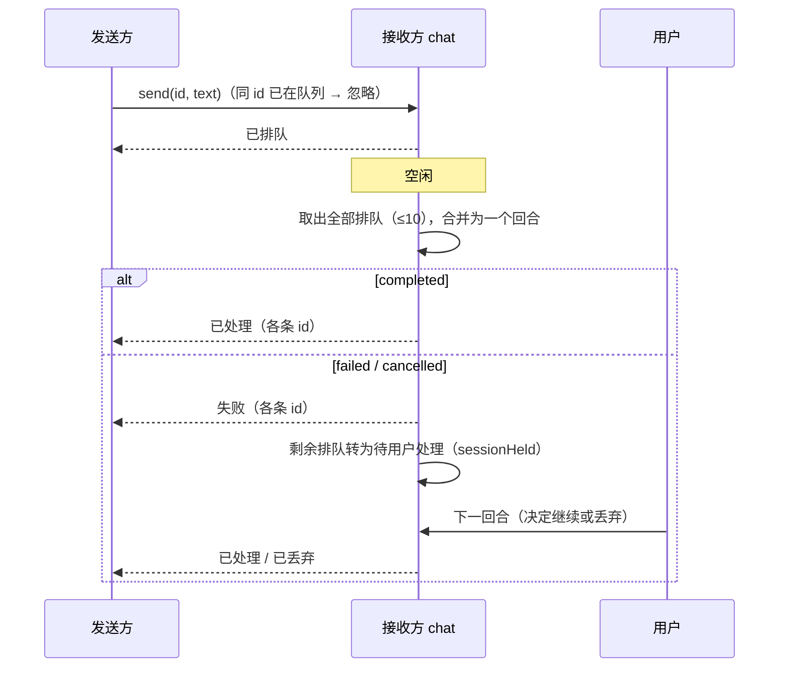

<!-- template_id: design; template_version: 1.1.1 -->
# 会话消息可靠投递 设计

> 状态：Approved 0.2（2026-10-22 用户：“批准消息设计”）/ 一期进入规划

## 修订记录

| 版本 | 日期 | 作者 | 摘要 |
|---|---|---|---|
| 0.1 | 2026-10-22 | Claude | 初稿：持久收件箱、消息 ID 去重、合并投递、回合提交才算处理完、失败重试、离线保留 |
| 0.2 | 2026-10-22 | Claude | 处理独立评审（`docs/review/2026-10-22-session-message-delivery-design-review.md`，BLOCKED，F1–F3 阻断）：取消自动重试，改为失败屏障“至多处理一次、失败可见”（F1）；合并回合跳数取最大值、被按住消息的状态定义（F2）；`suga send` 离线仍返回 3，离线入库仅显式开启且只认完整会话 ID（F3）；取件与恢复持锁并单事务（F4）；去重表述收窄、`--wait` 不变另加 `--wait-processed`（F5）；来源标签无条件加、taint 现状更正（F6）；接收方只限 chat、gofer 列为受影响调用方（F7）；队列上限与过期（F8）；新增备选与取舍，**分两期**：一期内存语义，二期持久化（F9） |

> 仅语义变化递增版本；纯 identity/provenance/元数据纠正沿用原版本，并在 Git/进度记录中留痕。

## 设计工作声明

- 思考模式：`RIGOROUS`。
- 核心目标：会话之间的消息不被重复处理、失败可见，发送方能知道消息是否处理完；在此基础上（二期）做到不因退出或离线而丢。
- Scope freeze：只改投递语义、确认与状态查询（一期）及收件箱持久化（二期）；不改消息内容格式、会话发现与选择器、gofer 信箱。
- 评审：低暴露（功能未实现；新表可回滚），一轮合并轴评审已完成（0.1 BLOCKED，本版处理）。
- 停止条件：用户裁决待确认事项并批准；评审预算已用，0.2 修订未复核，Gate 时披露。

## 背景与目标

第三十二批核实（`2026-10-21-session-message-design.md` 末尾“现状核实（2026-10-22）”）：

- 队列只在接收方 chat 进程内存里（`chatInputSource.deliveries`，容量 8），**不落盘**；chat 退出时 `DiscardQueued` 丢弃。
- 对方不在线直接失败（`suga send` 退出码 3，`ErrNotOnline`）——**gofer 依赖这个退出码**判断“对方不在线”并转用下一种投递方式（`gofer/internal/config/readonly.go:109-120` 调用 `suga send`）。
- 没有去重；“送达”只表示进了对方队列或对方回合开始；对方回合失败时发送方不知道；排队的下一条照常各起一个回合（没有失败屏障）。
- 每条消息各起一个回合，不合并。

用户可见结果：发出去的消息不会被处理两次；处理失败时双方都能看到，不会悄悄继续跑后面的消息；发送方能查到“已排队 / 正在处理 / 已处理 / 失败 / 待用户处理”。二期再加：退出与离线不丢。

## 名词

| 名词 | 含义 |
|---|---|
| 投递回合 | 接收方为处理一批排队消息而起的一个回合 |
| 已处理 | 投递回合正常提交（completed） |
| 失败屏障 | 投递回合失败或被取消后，剩余排队消息转为“待用户处理”，不自动继续，也不自动重试 |
| 待用户处理（held） | 由用户在接收方会话里决定继续或丢弃；沿用现有 `sessionHeld` 语义 |
| 消息 ID | 发送方给每条消息的 ID，用于状态查询与重复提交去重 |

## 范围与非目标

范围：`session_message` 工具与 `suga send` 投递到 **chat 会话**（唯一登记会话 socket 的接收方）。

受影响的调用方：gofer（经 `suga send` 投递给运行中的 suga 会话，依赖退出码 3）、`suga send` 的脚本用户、`session_message` 工具。

非目标：ACP 会话收件（ACP 不登记会话 socket）；跨机器；gofer 信箱 `agent:` 地址（gofer 以 ACP 提示投递，不经本机制）；`run` 一次性会话收件；改选择器或会话发现。

## 已确认事实与规范

- 发送：`internal/wiring/session_message.go` 的 `sessionMessenger.Send` → `personalprocess.Send`；接收：`internal/chat/chat_input.go` 的 `DeliverImages`、`deliveries`（容量 8）、`DiscardQueued`；会话消息强制 follow-up（`steer_send.go`）；跳数达上限的累积在 `sessionHeld`。
- 会话消息默认**不触发 taint**（现状，本设计不改）；来源标签由 chat 加，现有 `hasSourceTag` 允许正文以 `[xxx] ` 开头冒充来源（另记 issue，本设计在合并格式中无条件加标签）。
- 进程记录里有 `Features` 字段，可用于新旧版本兼容判断。
- 第三十二批已有 `invocation_id` 与会话文件锁、`recoverStaleSession`。
- SQLite 迁移按 gofer memory `suga-migration-large-ledger` 做大库耗时测试（二期）。

## 备选与取舍（SR1403 / SR1410）

| 方案 | 解决 | 不解决 | 成本 |
|---|---|---|---|
| 不做 | — | 重复处理、失败不可见、退出/离线丢失 | 0 |
| **一期：内存语义**（失败屏障 + 回合结束回执 + 合并 + 消息 ID） | 不重复、失败可见、发送方知道是否处理完、减少回合数 | 退出/离线仍丢（但发送方能看到“未处理”） | 小：只改 `internal/chat` 与 `session_message`/`suga send` 的回执，不改存储与协议 |
| 二期：持久收件箱 + 显式离线入库 | 退出/离线不丢 | — | 中：新表、迁移、取件持锁与恢复、背压与过期、版本兼容 |

**推荐分两期**：一期先把语义做对（这是正确性问题，风险最高），二期在一期语义之上加持久化（是可用性增强）。二期是否做、何时做由用户决定。

## 总体方案

### 一期：内存语义

1. **消息 ID**：`session_message` 的消息 ID 取该次工具调用的 `invocation_id`（工具结果返回该 ID）；`suga send` 可传 `--id`，不传则生成并打印。同一接收方对同一 ID 只入队一次（窗口为接收方进程生命周期内）。**去重只覆盖“同一次提交被重复投递”**，模型重新发送同样内容会得到新的 ID，不视为重复。
2. **合并投递**：接收方空闲时一次取出全部排队消息（上限 10），合成一个投递回合；每条消息**无条件**加来源标签（`[来自 <会话短名>]`，不依赖正文是否已有方括号）；回合的跳数取各条消息跳数的**最大值**，达上限的不进入合并，留在 `sessionHeld`。
3. **失败屏障**：投递回合 completed → 回执“已处理”；failed/cancelled → 本批消息回执“失败”，**不自动重试**；此时仍在排队的消息转为“待用户处理”（并入 `sessionHeld`），用户下一回合提交后才算已处理。语义是“**至多处理一次，失败可见**”。
4. **回执与查询**：发送方经现有 socket 等待；`suga send --wait` 语义**不变**（等到被取走），新增 `--wait-processed` 等到“已处理 / 失败 / 待用户处理”；`session_message` 新增 `status` 动作（按消息 ID，在接收方在线时查询）。
5. **退出**：chat 退出时仍丢弃排队消息（一期不持久化），但对每条排队消息回执“未处理（接收方退出）”，发送方可见。

### 二期：持久收件箱（待用户决定）

- 收件箱表 `session_inbox`；发送方写入存储，socket 只做唤醒；状态 queued → taken → processed / failed / held。
- **离线入库只在显式开启时**：`suga send --queue-offline` 且只接受**完整会话 ID**（离线目标无法用进程记录或短名解析）；默认仍返回退出码 3，gofer 的降级链不受影响。
- 取件与崩溃后 `taken` 的恢复都在**持有会话锁**时进行，与 `recoverStaleSession` 同一时点，取件用单个事务。
- 背压：每个接收方 queued 上限（如 100），超出拒绝；消息过期（如 24 小时）后标 failed，避免回滚再升级后执行过期指令。
- 新发旧收：用进程记录的 `Features` 判断对方是否支持收件箱，不支持则走一期路径。

## 架构（一期）

## 关键流程（一期）

## 安全、数据、运维与回滚

- 信任：来自其他会话的消息作为注入的用户侧消息，**不提升权限**；合并格式无条件加来源标签；`hasSourceTag` 冒充问题另记 issue 修复。taint 现状不变（是否让会话消息触发 taint 另议）。
- 数据：一期无新存储。二期新表 + 迁移（大库耗时测试）、保留期随 `suga data gc --retention`。
- 兼容：`suga send` 的退出码、`--wait` 语义不变；新增参数均为可选。gofer 无需改动（一期）。
- 回滚：一期纯代码语义，回滚即恢复旧行为；二期新表对旧版本不可见，回滚后排队消息滞留但不丢。

## 决策

| # | 决策 |
|---|---|
| D1 | 分两期：一期内存语义（屏障、回执、合并、ID），二期持久化（待用户决定） |
| D2 | 至多处理一次、失败可见：不自动重试；失败后剩余消息待用户处理 |
| D3 | 合并回合跳数取最大值，来源标签无条件加 |
| D4 | `suga send` 退出码与 `--wait` 语义不变；新增 `--wait-processed`、`--id` |
| D5 | 离线入库（二期）仅显式开启、只认完整会话 ID |

## 待确认事项

1. 是否按两期推进、一期先做（推荐）。
2. 合并上限 10 条是否合适。
3. 二期的离线保留与过期时间（推荐 24 小时）是否需要。

## 结论与人工计划 Gate

0.2 处理了独立评审的全部阻断项（F1–F3）与建议项（F4–F9），评审预算已用，0.2 的修订未经复核。用户可选择：按 0.2 批准一期进入规划；或要求对 0.2 再做一轮评审。批准不授权实施。
