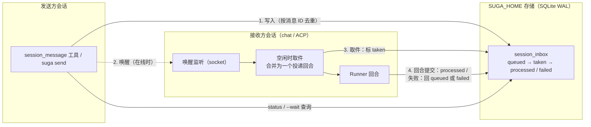
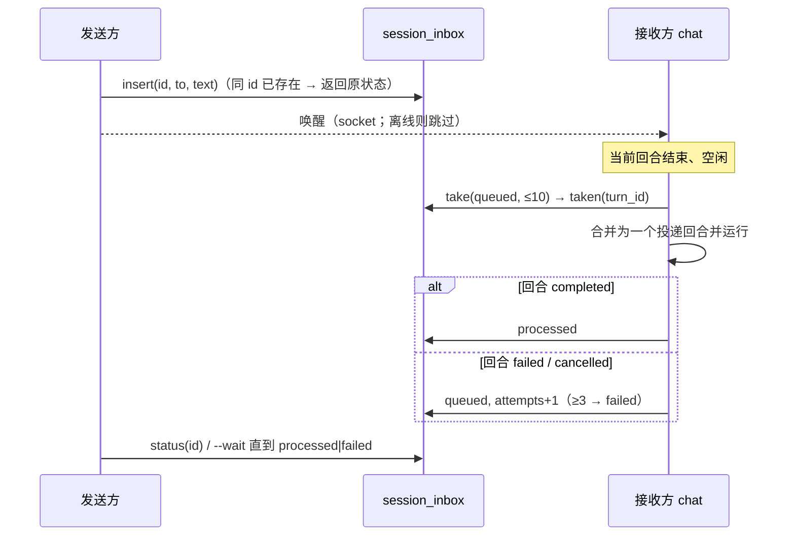

<!-- template_id: design; template_version: 1.1.1 -->
# 会话消息可靠投递 设计

> 状态：Draft 0.1 / 待人工计划批准

## 修订记录

| 版本 | 日期 | 作者 | 摘要 |
|---|---|---|---|
| 0.1 | 2026-10-22 | Claude | 初稿：持久收件箱、消息 ID 去重、合并投递、回合提交才算处理完、失败重试屏障、离线保留 |

> 仅语义变化递增版本；纯 identity/provenance/元数据纠正沿用原版本，并在 Git/进度记录中留痕。

## 设计工作声明

- 思考模式：`RIGOROUS`。
- 核心目标：会话之间的消息（`session_message` 工具、`suga send`）不丢、不重复，发送方能知道消息是否已被处理。
- Scope freeze：只改投递的存储、队列、确认语义与相应的状态查询；不改消息内容格式、跳数限制、会话发现与选择器、gofer 信箱。
- 评审：未投产的内部功能、可回滚（SR1409 低暴露）→ 一轮合并轴评审。
- 停止条件：评审无开放 `CORE_BLOCKING`，或用户裁决。

## 背景与目标

第三十二批核实（`2026-10-21-session-message-design.md` 末尾“现状核实（2026-10-22）”）发现当前投递是“尽力而为”：

- 队列只在接收方 chat 进程内存里（`chatInputSource` 的 `deliveries` 通道，容量 8），**不落盘**；chat 退出时 `DiscardQueued` 丢弃全部排队消息。
- 对方不在线时直接失败（`ErrNotOnline`），没有离线保留。
- **没有去重**：同一条消息重发就是两条。
- “送达”只表示进了对方队列或对方回合开始，**不表示被处理完**；对方回合失败后，发送方无从知道。
- 每条消息各起一个回合，不合并。

suga 要支撑长期会话和多会话协作（以后还有 xhen 的主题会话、gofer 信箱的 `agent:` 收件），这些都依赖可靠的会话间消息。用户可见结果：发出去的消息不会因为对方暂时离线或重启而丢失，也不会被处理两次；发送方能查到“已排队 / 正在处理 / 已处理 / 失败”。

## 名词

| 名词 | 含义 |
|---|---|
| 收件箱 | 每个会话在存储里的消息队列，跨进程、跨重启保留 |
| 消息 ID | 每条消息的唯一 ID（发送方生成或系统生成），用于去重与状态查询 |
| 投递回合 | 接收方为处理一批排队消息而起的一个回合 |
| 已处理 | 投递回合正常提交（completed）后，其中的消息才算已处理 |

## 范围与非目标

范围：`session_message` 工具与 `suga send` 的投递路径；接收方为 chat 会话（现状）与 ACP 会话（若当前支持）；状态查询（工具动作与 CLI）。

非目标：跨机器投递；gofer 信箱（由 gofer 投递到 ACP 会话，走 ACP 提示，不经本机制）；改变消息内容格式或跳数规则；`run` 一次性会话的收件（没有常驻进程，见待确认事项）。

## 已确认事实与规范

- 投递走会话 socket（`internal/wiring/session_message.go` 的 `sessionMessenger.Send` → `personalprocess.Send`），接收方排队在 `internal/chat/chat_input.go`（`DeliverImages`、`deliveries` 容量 8、`DiscardQueued`）。
- 会话消息不会插入运行中的回合，强制为 follow-up（`steer_send.go`）；跳数达上限的消息累积在 `sessionHeld`。
- suga 的存储为 SQLite（WAL，多进程共享同一 SUGA_HOME），会话条目与 meta 已有通用写入接口；新增表需迁移，遵守 gofer memory `suga-migration-large-ledger`（大库耗时测试）。
- 第三十二批 B 已有工具调用的 admitted/interrupted 台账与 `invocation_id`（发送工具可用它做幂等键）。
- 参考：whip 的持久邮箱（多条合并成一个摘要回合、回合提交才算送达、失败后重试屏障，`tmp/ext/whip/docs/concurrency.md:88-118`，外部仓库只读参考）。

## 总体方案

1. **持久收件箱**：新表 `session_inbox`（id、to_session、from_session、from_name、text、images 引用、hops、state、attempts、created_at、taken_turn、updated_at、error）。发送方把消息**直接写进存储**（与接收方共享同一个 SUGA_HOME），再经 socket 发一个“有新信”的唤醒；接收方不在线时消息留在收件箱。
2. **去重**：消息 ID 由发送方提供（`session_message` 工具用 `invocation_id`，`suga send` 可传 `--id`），同一收件人同一 ID 只入库一次，重复发送返回原消息的状态。
3. **合并投递**：接收方空闲时一次取出全部 `queued` 消息（上限如 10 条），合成**一个**投递回合：头部列出每条的来源与时间，正文依次给出；跳数规则照旧（达上限的继续累积）。
4. **处理确认**：取出时标 `taken`（记 turn_id）；投递回合正常提交 → `processed`；回合失败/取消 → 回到 `queued`、`attempts+1`；超过 3 次 → `failed`，并（若发送方在线）回一条“未能处理”的通知。重启时 `taken` 但回合未提交的消息按 `queued` 处理（不丢）。
5. **状态查询**：`session_message` 增加 `status` 动作（按消息 ID），`suga send --status <id>`；`--wait` 的语义改为等到 `processed`/`failed`（可选等到 `taken`，保留旧行为的开关）。
6. **退出不丢**：chat 退出不再丢弃排队消息（去掉 `DiscardQueued` 的丢弃语义，改为“留在收件箱”），下次打开该会话时投递。

## 架构

## 关键流程

- 接收方启动（打开或续接会话）时检查收件箱，有 `queued` 或残留 `taken` 的就安排投递回合。
- 发送方离线不影响已入库消息；`failed` 通知仅在发送方在线时发送，否则只留状态。

## 安全、数据、运维与回滚

- **信任**：来自其他会话的消息仍按现有规则处理（作为注入的用户侧消息，沿用现有的来源标注与 taint 规则，不提升权限）。
- **数据**：新表；`processed`/`failed` 消息保留 30 天（随 `suga data gc --retention`），`suga data usage` 统计包含该表。
- **迁移**：新增表的迁移按大库耗时规则测试；不改已有表。
- **回滚**：旧版本不读新表——回滚后在新版排队的消息会滞留在表中（不丢失，升级回来后继续投递）；旧版的 socket 直投路径保持可用（新版发送方对旧版接收方：检测对方版本，降级为旧路径，或明确报错，见待确认事项）。

## 决策

| # | 决策 |
|---|---|
| D1 | 收件箱持久化在共享的 SUGA_HOME 存储里，socket 只做唤醒 |
| D2 | 消息 ID 去重，工具调用用 `invocation_id` |
| D3 | 多条排队消息合并成一个投递回合（上限 10） |
| D4 | 回合正常提交才算 processed；失败重试最多 3 次后 failed |
| D5 | chat 退出不丢排队消息；重启后 taken 未提交的回到 queued |

## 待确认事项

1. **离线投递**：对方会话不在线时，消息留在收件箱等它下次打开（推荐），还是像现在一样直接报错？
2. **新发旧收**：新版发送方遇到旧版接收方（不读收件箱）：降级走旧的 socket 直投（推荐，兼容），还是报错要求升级？
3. **合并上限与头部格式**：一个投递回合最多 10 条是否合适；是否需要按发送方分组。
4. **`run` 一次性会话**：`suga run` 没有常驻进程，是否也作为收件人（下次 `run --resume` 时处理）？推荐：一期只支持 chat 与 ACP 常驻会话，`run` 会话返回“对方不接收消息”。

## 结论与人工计划 Gate

本设计把会话消息从“尽力而为的内存队列”改为“持久收件箱 + 去重 + 处理确认”。经一轮独立评审、用户确认待确认事项并批准后，再写实施计划；批准不授权实施。
