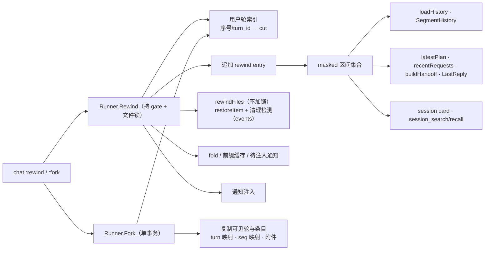

<!-- template_id: design; template_version: 1.2.0 -->
# suga 会话 rewind 与 fork 设计

> 状态：Draft 0.2 / 待人工计划批准

## 修订记录

| 版本 | 日期 | 作者 | 摘要 |
|---|---|---|---|
| 0.1 | 2026-10-31 | Claude | 初稿：依据 suga-4tnd 与只读调研，定 `:rewind N`（文件/会话/两者）与 `:fork N` 的数据模型、投影规则、命令面与边界 |
| 0.2 | 2026-10-31 | Claude | 处理两轴第 1 轮评审（`docs/review/2026-10-31-session-rewind-fork/`）。 阻断项： • 读者清单按“进入模型请求、交接包或用户可见当前状态”同类穷尽（S1、F2） • fork 为每轮生成新 turn_id 并写入 turns（F1） • 快照被清理时从 tool 事件检测（F3） 纠正项： • 屏蔽区间改为集合 API 并定义语义（F4） • cut 与用户轮定义（F6） • 不可重入锁下的文件回退函数与失败边界（F7、S4） • meta 与进程内状态重置（F8） • fork 细节（F9） • 模型侧检索排除被屏蔽内容（S2、F5） • trace 标注延后（S3） • SR1301 校验（S5） • taint 判据（S6） • 装配（S7） • review budget（S8） • 引用修正（S9） • 回滚披露（S10、F10） • 回填提问改为延后（S11） • 可测性（F11） |

> 仅语义变化递增版本；纯 identity/provenance/元数据纠正沿用原版本，并在 Git/进度记录中留痕。

## 设计工作声明

- 思考模式：`RIGOROUS`（SR1408）。
- 核心目标：用户在 chat 里能把会话回到第 N 轮，可以只回文件、只回会话或两者都回；也能从第 N 轮分叉出新会话，原会话保持不变。
- Scope freeze：只做 issue 的 ① rewind 和 ② fork，以及 runner 层 API 与 chat 命令。③ summarize-from-here、CLI `suga session`、ACP 与 sugasdk 暴露、trace 的“已回退”标注都不在本期。
- 暴露度：会话数据是用户资产，按 SR1409 不属低暴露。用户已确认两轴独立评审。
- Review budget：严谨模式最多 8 轮。第 1 轮 discovery 已完成；第 2 轮 confirmation 只读 `0ae0a20c..<0.2 candidate>` 的 diff 与依赖章节，无开放 `CORE_BLOCKING` 即停止。
- 停止条件：两轴都无开放 `CORE_BLOCKING`，交用户批准。

## 背景与目标

issue suga-4tnd 的验收要求：`:rewind N` 能只回文件、只回会话或两者都回；`:fork N` 生成分叉会话且原会话不变；有 e2e 与单测覆盖。

现状：`:checkpoints`/`:undo` 只回文件，N 指“最近 N 个有文件改动的轮”。会话本身不能回到某一轮，也不能分叉。

## 名词

- **轮**：`turns` 表的一行，即一次 `Runner.Run`，`turn_id` 形如 `t_…`。一轮内可以有多条 user entry，包括 steer、undo 通知、钩子上下文。
- **用户轮**：请求所对应的 user entry 不带 `suga.injected` 元数据的轮（`runner.go:679-683` 的 injectedStorage）。没有任何 entry 的轮、已被屏蔽的轮不算用户轮。用户轮序号从 1 开始。
- **cut（截断点）**：第 N 轮首条 entry 的 seq 减 1。两轮之间写入的、不属于任何轮的段记录（`:compact`、空闲整理、clear）都留在 cut 之前，不受影响。
- **回退记录**：本设计新增的 entry 类型 `rewind`，追加在会话末尾，内容为 `{cut_seq, target_turn, scope, files…}`。
- **屏蔽区间集合**：会话中所有回退记录的区间 `(cut_seq, rewind.seq)` 的并集。不论某条回退记录本身是否落在别的区间里，它的区间都计入集合。

## 范围与非目标

范围：
- runner 层：`Runner.Rewind`、`Runner.Fork` 与用户轮索引；
- 屏蔽区间 API，以及下文列出的全部读者改为经过它；
- 不加锁的“从最新到目标轮”文件回退函数，以及快照已清理的检测；
- chat 命令 `:rewind`、`:fork` 与确认交互；
- trace 事件、通知注入、i18n 文案；
- 单测与 Go ptye2e。

非目标：
- summarize-from-here、redo；
- CLI、ACP、sugasdk 新增 API；
- trace 与 transcript 的“已回退”标注；
- rewind 后把第 N 轮提问回填到输入行（S11）；
- 延长快照保留期、跨会话合并。

受影响项目：只有 suga。xhen 不回退，但 `sugasdk.Entries` 会返回新类型 `rewind`（`pkg/sugasdk/types.go:381` 原样透传 Type），需要在 CHANGELOG 说明。xhen 按 seq 读锚点（`link/anchor.go`），不受影响。

## 已确认事实与规范

- **序号不可重编**：entries 以 `(session_id, seq)` 为主键，seq 只追加（`internal/personal/store/entries.go:47-70`），在事务中分配。全仓没有删除单条 entry 的路径。sugasdk 承诺序号只追加（`pkg/sugasdk/doc.go:34-35`、`types.go:239`），所以不能物理截断。
- **`turns.id` 是全局主键**（`internal/personal/store/migrations/20261008-230000-create-core-store.sql:15-23`）。`loadHistory` 只采纳 `done[e.TurnID]` 为真或在 replay 中的条目（`internal/personal/context.go:206-208`），`done` 来自 `ListTurns`。
- **`loadHistory` 的处理顺序**（`context.go:111-236`）：先读全部 entries（Types 白名单在 `:128-130`），再按“最后一条被采纳的 compaction 胜出”取段快照、交接包与 `first_kept_seq`。两轴都已核实：先屏蔽、再走状态机，结果正确。具体包括：
  - `segmentSeq`、`firstKept`、`summary`、`updates` 回到 cut 之前最后一条被采纳的段记录；
  - interrupted 轮整轮屏蔽；
  - steer 与 undo 通知随所在的轮一起屏蔽。
- **必须经过屏蔽的读者**：凡是会进入模型请求、交接包或用户可见当前状态的 entry 读取，都要先过滤屏蔽区间。

  | 读者 | 位置 | 进入的地方 |
  |---|---|---|
  | `loadHistory` | `context.go` | 模型上下文 |
  | `SegmentHistory` | `segment_history.go` | ACP load 回放 |
  | `latestPlan` | `segment_handoff.go:97` | 交接包、nudge（`nudge.go:221`） |
  | `recentRequests` | `segment_handoff.go:111-160` | 交接包与 compaction 的 `RecentRequests` |
  | `buildHandoff` 的 `LatestEntry(EntryPlan)` | `handoff.go:124` | handoff 记录 |
  | `buildHandoff` 调用的 `recentRequests` | `handoff.go` | handoff 记录 |
  | `LastReply` | `lastreply.go:28` | resume 时显示的最后回复 |
  | session card 的 `RecentEntries`/`LatestEntry`/`CountEntriesByType` | `session_card.go:117-139` | Turns、OpenSteps、LatestSummary、SegmentCount |
  | 模型工具 `session_search`/recall 读当前会话 | `ledger.go:124,262` | 模型 |

- **不受影响的读者**（理由：按单个轮读取，而被屏蔽的轮不会再被采纳为当前轮）：
  - `compact.go:176`；
  - `replay.go:233`（`markInterruptedToolCalls`）；
  - `admit.go:165`；
  - `steer.go:418`（`turnSteers`）。
- **文件快照**：只在有写工具调用的轮存在（`BeforeCall`，`snapshots.go:154`）。保留策略（默认 20 轮 / 7 天，`snapshot_retention.go:19-20`）用 `removeCheckpoint` 整体删除目录，不留墓碑（`:620-628`）。`ListCheckpoints` 跳过无快照的轮（`undo.go:363-366`）。写工具调用记录在 events 中：`Kind=tool`，`Name∈{file_write, file_edit, file_remove}`（`observe.go:311`，`analyze.go:207` 有同类用法）。
- **锁与恢复函数**：gate 不可重入（`gate.go:115-140`）。`UndoCore.withSession` 自己取 gate（`undo.go:207-227`），所以 rewind 持锁时不能再调 `UndoWithOptions`（`undo_options.go:11,20`）。`restoreItem` 与 `contentConflict`（`undo_restore.go:346`）可以直接复用。恢复后要调用 `cfg.OnFilesRestored`（`undo_runner.go:29`），通知写保护层。
- **meta 与进程内状态**：
  - fold 基线是 `fold_boundary` 与 `fold_active` 两个字段（`segment.go:240-241`）；
  - `loaded_tools` 在 meta 中，同时还有进程内的 `Visibility` 段表（`pkg/agentcore/tools/visibility.go:316-322`）；
  - 前缀缓存用 `r.rec.prefix.clearRequest`（`segment_clear.go:128`）。
- **新会话**：`NewSessionWithMeta`/`insertSession` 会把 `Cwd` 设为 `r.cfg.Workspace`，并写一条新的 `reason=start` 段记录（`runner_sessions.go:98-187`）。大 body 需要 `HydrateEntries`（`store/toolbody.go:513`）。entry JSON 中只有 compaction 的 `first_kept_seq` 引用 seq（grep 已确认）。图片存为 `images/<sha>` 引用，spill 正文引用 `out:<会话>:<hex>`，compaction 的 `Refs` 形如 `<会话>/<seq>`。
- **taint**：`tainted_at` 是首次记录的 RFC3339 时间，精确到秒，写一次后永不清除（`taint.go:13-16,90-93`）。
- **旧版本兼容**：旧二进制的 `loadHistory` 按 Types 白名单读取，会忽略 `rewind`（`context.go:128-129`）。`trace_transcript.go:125-128` 对未知类型原样输出。
- **适用规范**：SR1107、SR1409、SR1301、GR104、GR108、GR109、GR110、SR2002–SR2004。

## 总体方案

### 1. rewind：追加回退记录 + 屏蔽区间集合

`Runner.Rewind(sid, target, scope)` 先持有 gate 与跨进程文件锁，再按 scope 处理会话和文件两部分，最后写事件、注入通知。

**会话部分**（scope 包含 conversation）：
1. 追加一条 `rewind` entry，`cut_seq` 按“名词”中的 cut 定义计算。
2. 屏蔽区间集合随之扩大。
3. 按第 3 小节重置 meta 与进程内状态。

**文件部分**（scope 包含 files）：
1. 按时间从最新的轮逆序处理到第 N 轮（含第 N 轮）。早先被 rewind 屏蔽的轮也要处理，因为它们对磁盘的改动还在。
2. 跳过已 `undone` 的轮；`partial` 的轮重跑，`restoreFile` 遇到内容已等于快照前的情况会幂等跳过。
3. 每轮恢复完调用 `SetCheckpointState`，全部结束后调用 `OnFilesRestored`。
4. 这部分用一个**不加锁**的新函数实现，内部直接循环调用 `restoreItem`。持锁的是 `Rewind`。
5. 已清理快照的检测：对目标区间内的每一轮，如果 events 里有写工具调用，但没有快照目录，就判定为“快照已清理”，把事件属性里的路径列为不可恢复。如果快照功能整体关闭，则所有写调用的路径都列为不可恢复，并在计划里写明原因。
6. 级联冲突：中间某一轮无法恢复时，更早轮里同一路径会因“当前内容不等于写入后哈希”被判为冲突并跳过。回退计划要把这一层效果展示出来。

**屏蔽区间 API**（`internal/personal/visible.go`）：
- 每个读者在一次读取前，先单独读出该会话的全部 `rewind` 记录（按 `type` 建了索引的小查询），构造区间集合 `masked`。
- `masked.Hidden(seq) bool` 判断某个 seq 是否在任一区间内。
- `loadHistory` 的 Types 白名单加入 `EntryRewind`，扫描时把它当作区间记录而不是消息。
- 限量查询（`RecentEntries`、`LatestEntry`、`CountEntriesByType`）改为跳过被屏蔽的条目，并补足数量。session card 的性能约束（`BenchmarkSessionCard`）要求补足靠分页继续读，不能整表扫描。
- 只要 cut 永远落在可见轮的边界上，嵌套回退的结果就是正确的。

### 2. fork：新会话 + 复制可见历史

`Runner.Fork(sid, target)` 的步骤如下：

1. **建会话**：在单个事务中创建新会话。
   - `cwd` 显式设为源会话的 cwd，不取当前 runner 的 Workspace。
   - 不写 `insertSession` 默认的那条 start 段记录，改为复制源会话中可见的段记录。
   - `:rw` 附加目录复制源会话的。
   - title 加上“（分叉）”后缀，origin 为 chat。
   - meta 记录 `forked_from` 与 `forked_at_turn`。
2. **复制轮**：源会话在 cut 之前、对投影可见的每一轮，都生成新的 turn_id。用 `CreateTurn` 写入 turns 行，复制 status、stop_reason、started_at、ended_at，不复制 state_json。保留“旧 turn_id → 新 turn_id”的映射，`sessions.last_turn_id` 设为最后一个复制的轮。
3. **复制条目**：
   - 先 `HydrateEntries` 取回全文，再用一次 `AppendEntries` 追加到新会话。seq 重新分配，entry 的 `TurnID` 按映射改写。
   - compaction 的 `first_kept_seq` 映射为“不小于它的第一条已复制条目”的新 seq。
4. **附件**：
   - 图片文件复制到新会话目录；
   - spill 文件复制过去，并把正文中的 `out:<源会话>:` 改写为新会话；
   - compaction 的 `Refs` 保留指向源会话。它们只用于检索，跨会话只读引用是可以接受的，需在决策 R6 中写明。
5. **不复制**：events（避免 usage 重复计费）、子 agent 会话、pin。
6. **taint**：只要源会话的 `tainted_at` 不晚于 cut 条目的 `created_at`，新会话就继承 `tainted_at` 与 `tainted_by`。这是保守做法。
7. **失败处理**：任一步失败，都按 Handoff 的做法执行 `DeleteSession` 加 `DeleteSessionFiles`。
8. **源会话**：不写入任何内容，也不加写锁。chat 持有跨进程文件锁，同一时刻不会有其他写者。

### 3. meta 与进程内状态（rewind 会话部分）

- **fold**：写 `fold_boundary=0`、`fold_active=false`。
- **`loaded_tools`**：保留现有集合，不重算。最多只是多列出几个工具，不影响正确性，因为 handoff 继承的工具没有对应的 tool entry。
- **前缀缓存**：调用 `clearRequest`。
- **后台任务**：
  - 有运行中的任务时，拒绝 rewind（见第 5 节）；
  - 已完成但尚未注入的任务通知要丢弃，并在回退计划中列出被丢弃的通知；
  - 队列中的 `suga.undo.pending` 通知同样丢弃，由本次 rewind 的通知取代。

### 4. 模型侧检索

当前会话的 `session_search`/recall 排除被屏蔽的条目，这样模型不会自己把被回退的内容检索回来。

`suga trace`、`Entries`、FTS 中的数据仍然保留，trace 照常显示（暂不加标注，见非目标）。

### 5. 选轮与校验（SR1301）

- `:rewind` 不带参数时，列出用户轮：序号、时间、提问首行、是否有写调用、快照是否已清理。
- N 可以是用户轮序号，也可以是 `turn_id`。`turn_id` 要校验三点：
  - 属于当前会话；
  - 不在屏蔽区间内；
  - 是用户轮。
  不满足就拒绝。
- 前置拒绝（rewind 与 fork 一致）：
  - 回合进行中：放回输入行，下一个提示符再执行，与 `:undo` 一致；
  - 有运行中的后台任务：拒绝，并提示先停止任务；
  - 会话已归档：拒绝。
- fork 继承 `:rw` 附加目录：新会话是同一用户在本机、同一工作区继续工作，权限面与源会话相同，所以继承。

## 架构

**代码组织**：

参照 suga 现有的 undo 分层：`internal/personal/undo*.go` 放 runner 层逻辑，`internal/chat/chat_undo.go` 放命令。

- **装配**：不变。`Rewind`/`Fork` 是 `Runner` 的方法，复用已有依赖（Repository、gate、snapshots、tasks）。`internal/wiring` 不改。
- **领域层新文件**：
  - `internal/personal/rewind.go`：Rewind、用户轮索引、回退记录；
  - `internal/personal/rewind_files.go`：不加锁的文件回退与清理检测；
  - `internal/personal/visible.go`：masked 区间集合；
  - `internal/personal/fork.go`：Fork、turn 映射与 seq 映射、附件。
- **命令层新文件**：`internal/chat/chat_rewind.go`，放命令与确认交互。
- **store**：`types.go` 新增 `EntryRewind`，DDL 不变（`type` 是 TEXT）。
- **依赖方向**：chat → personal → store。
- **规范适用性**：GR104 要求新文件各不超过 400 行。GR107（不新增入口）、SR2003（不新增 CLI）不适用。GR110 因为不新增 CLI 也不适用。

## 关键流程

### 1. `:rewind N [files|conversation|both]`（默认 both）

1. 解析 N，校验（见总体方案第 5 节）。通过后取 gate 与文件锁，并检查前置拒绝条件。
2. 生成回退计划，打印以下内容：
   - 会话：要屏蔽的轮数，以及要丢弃的待注入通知；
   - 文件：要恢复、删除、跳过（冲突，包括级联冲突）的文件，以及快照已清理的不可恢复文件；
   - shell_exec 造成的改动只做提示。
3. `chat.undo_confirm` 开启时（默认开）问 y/yes。没有 TTY 时取消。
4. 按 scope 执行文件部分。各种失败的处理边界：

   | 情况 | 处理 |
   |---|---|
   | 文件部分返回 error（锁、IO 中断） | 会话部分不执行；报告已恢复的文件，pre-undo 快照可找回 |
   | 出现 Failures/Skipped/Unrecoverable | 仍执行会话部分（R4），并列出这些文件 |
   | 文件已恢复，但写 `rewind` entry 失败 | 报告“文件已回退、会话未回退”，注入“文件已回退”通知，可重试只回会话 |
   | entry 已写，但 meta 重置或缓存清理失败 | 记 Warn 日志并报告；下一轮会按屏蔽后的投影重新计算 |

5. 写 `session` 事件（name 为 `rewind`，attrs 含目标轮、scope、文件统计），然后注入通知（见流程 3）。

### 2. `:fork N`

1. 校验与前置拒绝同上。
2. 执行 `Runner.Fork`。
3. 打印新会话 ID，以及 `suga chat --resume <id>` 提示。当前 chat 不切换会话（R7）。
4. 写 `session` 事件（name 为 `fork`）。

### 3. 通知

沿用 undo 的待处理通知队列，在下一回合注入。不另外入队通用 undo 通知，避免重复。按情况选用以下文案：
- 只回会话：“会话已回到第 N 轮；磁盘文件没有回退，请先重新读取相关文件再继续。”
- 只回文件：沿用现有 undo 文案。
- 两者都回，但有不可恢复或跳过的文件：列出这些文件。

## 安全、数据、运维与回滚

- **数据**：
  - 回退只追加 `rewind` entry，被屏蔽的条目仍然保留，序号承诺不变。
  - fork 只读源会话，自身在单个事务中完成，失败时清理掉新会话。
- **安全（SR1301）**：
  - 入参与资源归属的校验见总体方案第 5 节；
  - taint 在原会话保持不清，fork 时按规则保守继承；
  - 受保护路径与冲突策略沿用 undo；
  - fork 只复制本地 store 内的数据，不出机器。
- **运维**：回退后第一次请求必然缓存未命中；usage 不回退。
- **回滚到旧版本**（写入 CHANGELOG）：
  - 旧版本会忽略 `rewind` 记录，被屏蔽的区间会重新可见。新版本下 rewind 之后进行的新轮，会和已回退的分支拼接成一条上下文。
  - 旧版本下发生的 compaction 会把屏蔽区间的内容永久写进摘要，再升级回新版本也无法消除。
  - 因此回滚前，应先 fork 出需要的分支，或接受上下文混合。

## 决策

| # | 决策 | 依据 |
|---|---|---|
| R1 | rewind 用“追加回退记录 + 屏蔽区间”，不删、不改已有 entries | 序号只追加的承诺（xhen 依赖）；可审计；为 redo 留路 |
| R2 | 凡进入模型请求、交接包或用户可见当前状态的读者，都经屏蔽区间集合（清单见“已确认事实”） | 回退早于 compaction 或 handoff 时内容不泄漏；状态机不用改（两轴已核实） |
| R3 | N 是用户轮序号或 turn_id；不带参数时列出可回退的轮；turn_id 校验归属、是否被屏蔽、是否为用户轮 | 与用户在 chat 中看到的轮一致；SR1301 |
| R4 | 快照已清理时部分恢复：用 tool 事件检测并列出不可恢复项，执行前确认 | 保留期 20 轮 / 7 天；用户已确认 |
| R5 | 只回会话时，强制在下一轮注入“磁盘未回退”的通知 | 避免模型基于错误的文件状态继续工作 |
| R6 | fork 为每个轮生成新 turn_id，seq 重新分配；复制图片与 spill；compaction Refs 保留跨会话只读引用；不复制 events、子会话、pin；taint 按 created_at 保守继承；单事务完成，失败清理 | 新会话可以续聊、原会话不变；避免重复计费；安全保守 |
| R7 | fork 之后不切换当前 chat | 运行中切换会话没有先例；用户已确认 |
| R8 | 回合进行中先放回、有运行中的后台任务时拒绝、会话已归档时拒绝（rewind 与 fork 一致）；已完成但未注入的任务通知与 undo 通知丢弃并列出 | 与 ClearContext 一致；避免指向已不可见的上下文 |
| R9 | 本期只做 chat 与 runner API；CLI、ACP、sugasdk、summarize、trace 标注、提问回填都延后 | scope freeze（S3、S11） |
| R10 | rewind 移出 0.53，排进 0.54 | 用户已确认 |
| R11 | 当前会话的 session_search/recall 排除被屏蔽条目；trace、Entries、FTS 数据保留 | “回到第 N 轮”对模型而言要彻底；数据仍可审计（S2、F5） |
| R12 | `loaded_tools` 保留不重算；fold 两个字段都重置；清前缀缓存 | handoff 继承的工具没有 tool entry，无法重算；保留只会多列工具（F8） |

## 待确认事项

用户已于 2026-10-31（web）确认：rewind 移到 0.54，原待确认 1–4 按推荐执行，采用两轴独立评审。

0.2 新增的 R11（模型侧检索排除被屏蔽内容）与 R12（`loaded_tools` 保留不重算）都是推荐取舍，交批准时一并确认。

## 结论与人工计划 Gate

方案：
- rewind 追加回退记录，所有进入模型或当前状态的读者都经同一个屏蔽区间集合；文件部分用不加锁的恢复函数，配合清理检测。
- fork 复制可见的轮与条目，并重新映射 turn 与 seq。
- 两者都不破坏序号只追加的承诺。

两轴第 2 轮确认无开放 `CORE_BLOCKING` 后交用户批准，批准后写实施计划。设计批准不授权实施。
