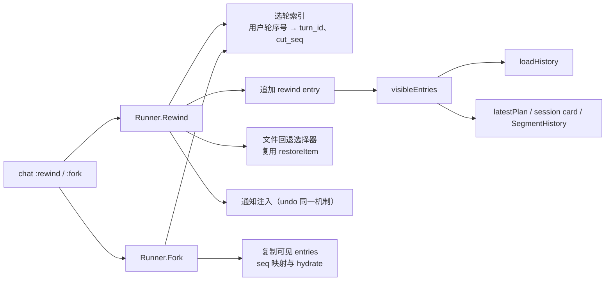

<!-- template_id: design; template_version: 1.2.0 -->
# suga 会话 rewind 与 fork 设计

> 状态：Draft 0.1 / 待人工计划批准

## 修订记录

| 版本 | 日期 | 作者 | 摘要 |
|---|---|---|---|
| 0.1 | 2026-10-31 | Claude | 初稿：依据 suga-4tnd 与只读调研，定 `:rewind N`（文件/会话/两者）与 `:fork N` 的数据模型、投影规则、命令面与边界 |

> 仅语义变化递增版本；纯 identity/provenance/元数据纠正沿用原版本，并在 Git/进度记录中留痕。

## 设计工作声明

- 思考模式：`RIGOROUS`（SR1408）。
- 核心目标：用户在 chat 里能把会话回到第 N 轮（只回文件、只回会话或两者），并能从第 N 轮分叉出新会话，原会话不变。
- Scope freeze：只做 issue 的 ①（rewind）和 ②（fork），以及 runner 层 API 与 chat 命令。③ summarize-from-here、CLI `suga session`、ACP 与 sugasdk 暴露都不在本期。
- 暴露度：suga 是用户日常工具，会话数据是用户资产，按 SR1409 不属于低暴露。改动只追加记录，不删、不改已有 entries，可回滚。评审按两轴独立（规范轴、可执行轴）各一轮，或由用户裁决降为一轮合并轴。
- 停止条件：评审无开放 `CORE_BLOCKING`，交用户批准。

## 背景与目标

issue suga-4tnd 的验收标准：
- `:rewind N` 可只回文件、只回会话或两者；
- `:fork N` 生成分叉会话，原会话不变；
- 有 e2e 与单测覆盖。

现状：
- `:checkpoints`/`:undo` 只回文件，而且 N 指“最近 N 个有文件改动的轮”；
- 会话本身不能回到某轮，也不能分叉。

## 名词

- **轮**：`turns` 表的一行，即一次 `Runner.Run`，`turn_id` 形如 `t_…`。一轮内可以有多条 user entry，包括 steer、undo 通知、钩子上下文。
- **用户轮序号**：只给用户在 chat 中发起的轮编号，从 1 开始。`Request.Injected`、nudge 等非人工发起的轮不编号。
- **回退记录**：本设计新增的 entry 类型 `rewind`，写在会话末尾，内容为 `{cut_seq, target_turn, scope, files…}`。
- **回退区间**：`(cut_seq, rewind 记录的 seq)` 之间的 entries，投影时被屏蔽。

## 范围与非目标

范围：
- runner 层 `Runner.Rewind`、`Runner.Fork` 与选轮索引；
- `loadHistory` 与所有“最后写入胜出”读者的区间屏蔽；
- 文件回退“从最新到目标轮”的选择器；
- chat 命令 `:rewind`、`:fork` 及确认交互；
- trace 事件、通知注入、i18n 文案；
- 单测与 Go ptye2e。

非目标：
- summarize-from-here；
- redo，后续可在回退记录上实现；
- CLI、ACP、sugasdk 暴露；
- 延长快照保留期；
- 跨会话合并。

受影响项目：只有 suga。xhen 不受影响，因为序号承诺不变，sugasdk 不新增 API。

## 已确认事实与规范

- entries 以 `(session_id, seq)` 为主键，seq 只追加（`store/entries.go:70`），全仓没有删除单条 entry 的路径。sugasdk 承诺序号只追加、不重编（`pkg/sugasdk/doc.go:34-35`、`types.go:239`），xhen 依赖这一点，所以**不能物理截断**。
- `loadHistory`（`internal/personal/context.go:111-236`）先读全部 entries，再按“最后一条已采纳的 compaction 胜出”取段快照、交接包与 `first_kept_seq`，然后按 `done`/`replay` 过滤。
- 同类“最后写入胜出”的读者：
  - `latestPlan`（`segment_handoff.go:97`）；
  - fold 基线与 `loaded_tools`：会话 meta；
  - session card 的 Turns、OpenSteps、LatestSummary（`session_card.go`）；
  - `SegmentHistory`（`segment_history.go`，ACP load 回放）。
- 文件快照按轮存放（`snapshots.go:154`），只存在于有写工具调用的轮；默认保留 20 轮或 7 天（`snapshot_retention.go:19-20`）。
- 恢复入口是 `UndoWithOptions{TurnID, Count, Force}`（`undo_options.go:20`），冲突默认跳过、`force` 覆盖（`undo_restore.go:346`），受保护路径永不写。
- 回合进行中输入 `:undo` 会被放回输入行（`chat/steering.go:205-212`）。`ClearContext` 先 `gate.Acquire` 加文件锁，拒绝运行中或已归档的会话（`segment_clear.go:49-69`）。
- 新会话：`NewSessionWithMeta`/`insertSession`（`runner_sessions.go:98-170`）；handoff 只读源会话（`handoff.go:61-98`）；大 body 需要 `HydrateEntries`（`store/toolbody.go:513`）。
- taint 是会话 meta，写一次、永不清除（`taint.go:15-18`）。
- usage 由 events 聚合（`store/events.go:141`）。
- 规范：SR1107（DPI-flow）、SR1409、SR1301、GR104、GR108、GR109、SR2002。

## 总体方案

### 1. rewind = 追加回退记录 + 投影屏蔽区间（不删数据）

`Runner.Rewind(sid, target, scope)`：
- **会话部分**（`scope` 含 conversation）：
  - 追加一条 `rewind` entry，`cut_seq` = 目标轮之前最后一条 entry 的 seq，也就是第 N 轮开始前的状态。
  - 投影时，`(cut_seq, rewind.seq)` 之间的 entries 全部屏蔽。
- **文件部分**（`scope` 含 files）：
  - 对“从最新到第 N 轮（含）”的所有有快照的轮，按时间逆序复用 `restoreItem` 恢复，同一路径收敛到第 N 轮开始前的内容。
  - 快照已被保留策略清掉的轮列为 unrecoverable。
- 写 `session_rewind` 事件，并按需注入通知，见“关键流程 3”。

**区间屏蔽统一放在一个函数里**：`visibleEntries(entries) []Entry`。它按 seq 顺序扫描，遇到 `rewind` 记录就屏蔽它之前、`cut_seq` 之后的条目，嵌套的多次回退自然叠加。所有“最后写入胜出”的读者都改为先经过它，包括 `loadHistory`、`latestPlan`、session card、`SegmentHistory`。于是：
- 回退点早于最近一次 compaction 或 clear 时，那条 compaction 落在被屏蔽的区间里，状态机自动退回到 `cut_seq` 之前最后一条被采纳的 compaction，摘要不会泄漏被回退的内容。
- plan 与 `context_update` 同理。

会话 meta 里的 fold 基线与 `loaded_tools` 不在 entries 中，回退时重置为区间之前的状态：
- fold 基线清空（下一轮重新计算）；
- `loaded_tools` 从可见区间的 tool entries 重算。

### 2. fork = 新会话 + 复制可见 entries

`Runner.Fork(sid, target)`：
- 新建会话：
  - `cwd`、`:rw` 附加目录、title（加“（分叉）”后缀）从源会话复制；
  - origin 为 chat；
  - meta 记录 `forked_from`、`forked_at_turn`。
- 复制源会话中、在第 N 轮之前且对投影可见的 entries（经过 `visibleEntries`）：
  - 先用 `HydrateEntries` 取回全文，再 `AppendEntries` 追加到新会话，seq 重新分配；
  - compaction 记录里的 `first_kept_seq` 等内部 seq 引用按映射表重写；
  - 图片与外置 body 按新会话自己的规则重新写入，不跨会话引用。
- 下面这些不复制：
  - events，避免 usage 重复计费；
  - 子 agent 会话；
  - pin。
- taint：复制的区间里只要有外部来源的内容，新会话就继承 taint；判断依据是源会话的 `tainted_at` 早于 cut。
- 原会话不写入任何内容（只读，与 handoff 同样不加写锁）。

### 3. 选轮：用户轮序号

- `:rewind` 不带参数时，列出可回退的轮：用户轮序号、时间、提问首行、是否有文件快照、快照是否已被清理。
- N 指用户轮序号；也接受 `turn_id`（`t_…`）。
- 非人工发起的轮（injected、nudge）不编号。回退到第 N 轮时，它们随所在区间一起被屏蔽。
- 已被屏蔽的轮不再出现在列表里。

## 架构

**代码组织**：

- 参照 suga 现有的 undo 分层：`internal/personal/undo*.go` 负责 runner 层逻辑，`internal/chat/chat_undo.go` 负责命令，`internal/cli/undo.go` 是 CLI（本期不做 CLI）。
- 新文件：
  - `internal/personal/rewind.go`：`Rewind`、选轮索引、回退记录；
  - `internal/personal/visible.go`：`visibleEntries`；
  - `internal/personal/fork.go`：`Fork`、seq 映射；
  - `internal/chat/chat_rewind.go`：命令与确认。
- `store/types.go` 新增 `EntryRewind`。DDL 不变（`type` 是 TEXT）。
- 依赖方向沿用现状：chat → personal → store。GR104：新文件各不超过 400 行。

## 关键流程

### 1. `:rewind N [files|conversation|both]`（默认 both）

1. **前置拒绝**：
   - 回合进行中：放回输入行，等下一个提示符再执行，同 `:undo`。
   - 有运行中的后台任务：拒绝，并提示先 `:tasks stop`。
   - 会话已归档：拒绝。
2. 取 `gate.Acquire` 与文件锁（复用 chat 已持有的 `heldLocks`）。
3. 解析 N，得到目标轮与 `cut_seq`，并生成回退计划：
   - 会话：将屏蔽多少轮；
   - 文件：将恢复、删除、跳过（冲突）的文件，以及不可恢复（快照已清理）的轮；
   - shell_exec 造成的改动：只提示，不回退。
4. 打印计划。`chat.undo_confirm` 开启（默认）时问 y/yes；没有 TTY 时取消。
5. 执行：
   - 文件部分（若含）先做：失败时会话部分不执行，并报告结果。
   - 然后写 `rewind` entry 与 `session_rewind` 事件；
   - 重置 fold 基线与 `loaded_tools`；
   - 清前缀缓存。
6. 把第 N 轮的用户提问回填到输入行，供编辑后重发（对齐 Reasonix）。

### 2. `:fork N`

1. 前置检查同上。fork 只读源会话，回合进行中也拒绝，以免复制到半轮。
2. 解析 N，复制可见 entries 到新会话。
3. 打印新会话 ID 与 `suga chat --resume <id>` 提示。当前 chat **不切换**会话：切换涉及运行中换会话锁、标题与渲染，目前没有先例，留到后续。
4. 写 `session_fork` 事件。

### 3. 文件与会话不一致时的通知

沿用 undo 的待处理通知队列，在下一回合注入一条 user 消息：
- 只回会话不回文件：“会话已回到第 N 轮；磁盘文件没有回退，请先重新读取相关文件再继续。”
- 只回文件：沿用现有 undo 通知文案。
- 两者都回、但有不可恢复或被跳过的文件：列出这些文件。

## 安全、数据、运维与回滚

- **数据**：
  - 回退只追加 `rewind` entry，被屏蔽的 entries 仍保留：`suga trace`、`Entries`、`session_search` 都能看到，trace 会把它们标为“已回退”。
  - 序号承诺不变。
  - fork 只读源会话。
- **安全（SR1301）**：
  - taint 在原会话保持不清；fork 时按复制区间是否含外部内容决定是否继承。
  - 受保护路径与冲突策略沿用 undo。
- **运维**：
  - 回退后第一次请求必然缓存未命中，属于预期。
  - usage 不回退（已发生的花费）。
- **回滚**：功能本身的回滚就是删除新代码。`rewind` entry 在旧版本里是未知类型，旧版本的 `loadHistory` 只认列出的 types，会忽略它。因此回到旧版本时，被屏蔽的区间会重新可见，这一点需写进 CHANGELOG。

## 决策

| # | 决策 | 依据 |
|---|---|---|
| R1 | rewind 用“追加回退记录 + 投影屏蔽区间”，不删、不改已有 entries | 序号只追加的承诺（xhen 依赖）；可审计；给后续 redo 留路 |
| R2 | 所有“最后写入胜出”的读者经同一个 `visibleEntries` | 回退早于 compaction 时摘要不泄漏，状态机不用改 |
| R3 | N 指用户轮序号，同时接受 `turn_id`；无参数时列出可回退的轮 | 与用户在 chat 里看到的轮一致；`:undo N` 的含义不同，不复用 |
| R4 | 快照已清理时部分恢复，列出不可恢复项，执行前确认 | 保留期 20 轮 / 7 天；整体拒绝会让回退会话也做不了 |
| R5 | 只回会话时，强制在下一回合注入“磁盘未回退”通知 | 避免模型基于错误的文件状态继续 |
| R6 | fork 复制可见 entries，seq 重新分配并重写内部引用；不复制 events、子会话、pin；按区间继承 taint | 原会话不变；避免重复计费；安全保守 |
| R7 | fork 后当前 chat 不切换会话，只打印 ID 与 resume 提示 | 运行中切换会话没有先例，风险大 |
| R8 | 回合进行中、有运行中的后台任务、会话已归档时拒绝 | 与 ClearContext 一致；避免回退后任务结果指向不可见的上下文 |
| R9 | 本期只做 chat 与 runner API；CLI、ACP、sugasdk、summarize 后续再做 | scope freeze |
| R10 | **rewind 移出 0.53，排进 0.54**（用户已确认） | 0.53 其余项（B 波、S50A1、S50C）已接近完成；rewind 涉及会话数据，需要两轴评审与较长验证，不宜拖住 0.53 |

## 待确认事项

已由用户确认（2026-10-31，web：“rewind 移到 0.54，按推荐，两轴评审”）——以下 1–4 按推荐执行，评审为两轴独立：
1. R10：rewind 移到 0.54，v0.53.0 不等它。（推荐）
2. R1：投影屏蔽，而不是每次 rewind 都变成 fork 并更换会话 ID。（推荐，会话 ID 不变）
3. R4：快照已清理时部分恢复并列出不可恢复项。（推荐）
4. R7：fork 后不切换当前 chat。（推荐）
5. 评审级别：两轴独立评审（会话数据不属于低暴露），还是你裁决降为一轮合并轴评审。

## 结论与人工计划 Gate

方案：
- rewind 追加回退记录，在投影层统一屏蔽被回退的区间，文件部分复用 undo 的恢复逻辑；
- fork 复制可见 entries 生成新会话。
- 两者都不破坏序号只追加的承诺。

待确认事项定下、评审无开放 `CORE_BLOCKING` 后，交用户批准；批准后写实施计划。设计批准不授权实施。
