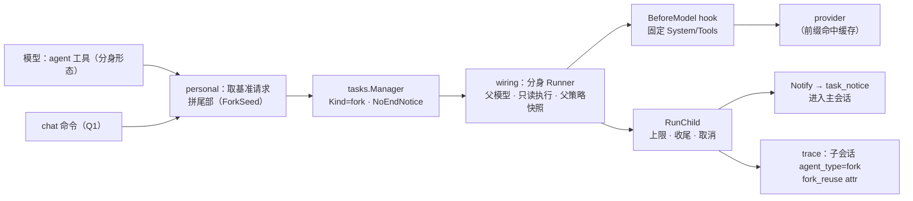

<!-- template_id: design; template_version: 1.2.0 -->
# suga 后台分身（fork）设计

> 状态：Draft 0.1 / 待人工计划批准

## 修订记录

| 版本 | 日期 | 作者 | 摘要 |
|---|---|---|---|
| 0.1 | 2026-11-26 | Claude | 初稿：依据 suga-hao6 与只读调研，定分身的触发面、上下文快照（沿用主循环请求前缀）、只读执行、回交与观测，列出待确认 Q1–Q5 |

> 仅语义变化递增版本；纯 identity/provenance/元数据纠正沿用原版本，并在 Git/进度记录中留痕。

## 设计工作声明

- 思考模式：`RIGOROUS`（SR1408）。
- 核心目标：主会话能派出一个“分身”在后台做子任务。分身带着主会话此刻的全部上下文起步，并沿用主会话的请求前缀以命中缓存；它的中间过程不进主会话，只回交结论。
- Scope freeze：只做“只读分身”：触发入口、上下文快照、执行与权限、回交、trace 与 `:tasks`。不做分身写文件、续聊分身会话、分身再派分身、跨进程存活、ACP 回合外推送（见“范围与非目标”）。
- 暴露度：**Full**（依据见“安全、数据、运维与回滚”第 1 条）。
- Review budget：按 SR1409 Full 档做两轴独立评审，轮次按 `planning-core-rigorous` 的规则执行；用户要求治理从轻，所以评审只看本文的核心选择与 CORE_BLOCKING，不展开相邻架构。
- 停止条件：Q1–Q5 由用户拍板，评审无开放 `CORE_BLOCKING`，交用户批准进入计划。

## 背景与目标

issue suga-hao6（用户 2026-11-07 的想法；2026-11-26：“hao6 出设计”）：派生一个继承当前会话全部对话上下文的后台 agent 去做子任务。用户关心两点：

1. 普通子 agent（`agent` 工具）要从零探索、重复读文件，起步成本高；分身已经知道主会话读过什么、在做什么。
2. 分身的工具输出与中间过程不进入主会话，只回交结论，主会话的上下文不被占用。

用户可见结果：

- chat 里模型（或用户）派出分身后，主会话立刻可以继续；分身在 `:tasks` 里显示为一项后台任务，可以 kill。
- 分身结束时，主会话收到一条带结论的通知；chat 空闲时会被唤醒继续（沿用 `tasks.wake_on_exit`）。
- 分身的第一次请求命中主会话已缓存的前缀，`suga inspect trace --json` 能看到它的缓存命中与 `fork_reuse` 结果。
- 分身的用量计入主会话累计；trace 能从主会话跳到分身会话。

## 名词

- **分身（fork）**：一次后台子 agent 运行，起步上下文是主会话此刻的请求；本文简称分身。注意与 chat 的 `:fork N`（会话分叉，复制历史到新会话供人续聊）不同。
- **基准请求**：主会话最近一次主循环请求（`prefixTracker.lastRequest`，System、Tools、Messages 原样）。
- **分身请求**：基准请求加上“尾部”：模型触发时是那条含分身调用的 assistant 消息与对应工具结果（任务指令）；用户命令触发时是上一轮的最终回复与一条 user 指令。
- **前缀沿用**：分身请求的 System、Tools 与基准请求的 Messages 逐字节不变，只在末尾追加。与交接包沿用前缀（`docs/design/2026-10-27-handoff-prefix-reuse-design.md`）是同一做法。

## 范围与非目标

范围（仅 suga 仓库）：

- `agent` 工具新增分身形态（Q2），只以后台方式运行；
- chat 用户命令（Q1）；
- personal 层：取基准请求、组装分身请求、固定请求头；
- wiring 层：分身 Runner 的装配（只读执行、沿用父模型）；
- 回交通知、trace attrs、`:tasks` 显示；
- 单测、GR110 分发测试、ptye2e 场景、Windows 主机验证、一次真实模型缓存实测。

非目标：

- 分身写文件或执行 shell（Q3 选 A 时）；
- 续聊分身会话（不提供 `--resume`）；分身再派分身或子 agent；
- 分身使用与主会话不同的模型（换模型就没有共享缓存，那正是现有 `agent` 工具）；
- 进程退出后分身存活、ACP 回合外推送、gofer 侧新契约；
- 同一回复里多个分身调用并行执行以外的调度改动（仍按顺序启动，各自在后台跑）。

受影响项目：只有 suga。gofer 经 `-a suga` 接入时，分身就是一项普通后台任务，`run` 结束前的收尾提醒照常生效，不需要新契约。

## 已确认事实与规范

以代码为准（2026-11-26，HEAD `bc0e9ca5`）：

- **子 agent**：`pkg/agentcore/tools/native/agent.go` 的 `AgentTool` 只做参数、结果与元信息（`ReadOnly`），`background: true` 时作为 `tasks.Spec{Kind:"agent", NoEndNotice:true}` 运行，结束时 `Notify` 报告前 12 行（`agentNoticeLines`）加用量 footer，全文在 task output。`internal/personal/subagent.go` 的 `RunChild` 新建子会话（meta `kind=agent`、`parent_session_id`、`parent_turn_id`、`parent_call_id`、`agent_type`），处理软截止、收尾与取消；用量经 `SumUsageTree` 计入父会话。
- **子 Runner 装配**：`internal/wiring/subagent.go` 每次调用自建 store 句柄与 provider（共享 `llm.Pool` 的观察者会被替换），只注册白名单只读工具，审批取父策略快照（`childPolicy`），询问类一律失败关闭，外部来源守卫按“无人可问”形式运行；后台且子会话被污染时 `markTainted` 父会话。
- **子 agent 不沿用前缀**：子 Runner 有自己的系统提示词与工具表，与主会话请求完全不同，起步全价。
- **主循环请求可原样取回**：`prefixTracker.observeRequest` 保存每次主循环请求（运行时自己的副本、发出后不再修改，host hook 已作用于它），`lastRequest` 取回，段断点时 `clearRequest`（`internal/personal/prefix.go:341-372`）。
- **前缀沿用已有先例与教训**：交接包沿用调用只追加一条 user 指令，Tools 照常声明、不发 `ToolChoice`——实测 `tool_choice: none` 会让网关丢掉工具定义，缓存不命中（`segment_handoff_reuse.go:118-131`，设计 0.3 的 H5）。没有进程内基准请求时可按持久化视图重建（`requestBaseBetweenTurns`），有 host hook 时不可重建（`handoffFallbackHostHook`）。段内前缀复用率实测 100%（suga-jh7b 关闭说明）。
- **请求头可由 hook 固定**：agentcore 把 `BeforeModel` 收到的 `event.Request` 原样发给 provider（`pkg/agentcore/runtime.go:376-402`），所以分身 Runner 能用自己的 hook 把 System、Tools 换回基准请求，不需要改 agentcore。
- **任务管理**：`pkg/agentcore/tasks` 按会话登记，`max_running` 默认 4（shell、agent 共用），`Kill` 取消函数任务的 ctx；结束通知作为 `task_notice` entry 落库，下一次请求前追加；chat 空闲时按 `tasks.wake_on_exit` 唤醒；`run` 在最终答复前提醒一次先 wait 或 kill，之后终止仍在运行的任务；ACP 的管理器挂在进程上，通知进下一个 prompt（`docs/design/2026-10-13-background-tasks-design.md` 实施记录）。chat 的 `:tasks [-a|-k <ID>]` 已存在（`internal/chat/chat_commands.go`）。
- **会话分叉**：`Runner.Fork` 复制可见历史到新会话供人续聊（`internal/personal/fork.go`，rewind/fork 设计 0.2 的 R6），meta 默认拒绝复制。它解决的是“从第 N 轮另起一条可续聊的会话”，不是后台执行；没有 `suga session fork` CLI。
- **适用规范**：SR1107、SR1403、SR1409、SR1410、GR104、GR108、GR109、GR110、SR2002；AGENTS.md 的“验证”一节（ptye2e、`suga inspect trace --json`、反向验证、Windows 主机）。

## 总体方案

一句话：**分身 = 现有后台子 agent 的执行与回交 + 以主会话基准请求为起点的请求头**。

1. **触发**：模型调用 `agent` 工具的分身形态（Q2），或用户在 chat 输入命令（Q1）。两者都只在挂了任务管理器时可用，且总是后台运行。
2. **快照**：不复制 transcript，也不改投影。取进程内的基准请求（模型触发时它就是刚产生这次调用的那个请求，必然存在），拼上尾部得到分身的第一次请求：
   - 模型触发：尾部是那条 assistant 消息（含分身调用），以及每个工具调用的结果。分身调用的结果写任务指令（“你是分身……”加 prompt）；同一回复里的其他调用写占位“（未在分身中执行）”，保证调用与结果成对。
   - 用户命令触发：尾部是上一轮最终回复加一条 user 指令。没有进程内基准请求（刚续接、段断点刚清掉）时，按 `requestBaseBetweenTurns` 重建；重建不了（有 host hook、前缀已变）就回退为“按持久化历史正常组装”：上下文仍完整，只是不沿用缓存，并记录原因。
3. **请求头固定**：分身 Runner 挂一个 `BeforeModel` hook，把每次请求的 System 与 Tools 换成基准请求的值，Messages 为“分身请求 + 分身自己新增的消息”。不发 `ToolChoice`。这样分身每一步都在同一前缀上追加。
4. **执行**：复用 `RunChild` 与子 agent 工厂：自建 store 句柄与 provider、父策略快照、`agents.*` 上限、收尾与软截止。差别只有三处：
   - 模型与 provider 配置取主会话本次使用的（不看 `agents.model`），否则没有共享缓存；
   - 工具表对模型声明的是基准请求里的全部工具（为了前缀），但执行层只放行白名单只读工具（Q3），其余调用返回“分身只读，需要改动请写进报告”的错误结果；`agent`、`task`、`tool_search` 一律拒绝（防递归，且加载新工具会改动前缀）；
   - 分身不做段断点或压缩：估算超过阈值时请求收尾，`stop=context`。
5. **回交**：沿用后台 agent 的 `Notify` 路径（Q4 定内容），通知作为 `task_notice` 进入主会话上下文；全文在 `task output`。
6. **观测**：分身会话 `kind=agent`、`agent_type=fork`，沿用现有子会话过滤、gc、`SumUsageTree`；新增 meta `fork_base`（主会话 id、基准请求所在 turn、尾部来源）与 model 事件 attr `fork_reuse=prefix|fallback:<reason>`。

## 架构

代码组织（参照 suga 现有子 agent 分层，依赖方向 chat → personal → store、wiring 只装配，GR108）：

- `pkg/agentcore/tools/native/agent.go`：分身形态的参数、描述与结果格式；`AgentRequest` 增加取尾部所需的调用信息。不依赖 internal。
- `internal/personal/subagent_fork.go`（新）：取基准请求、拼尾部、固定请求头的 hook、回退原因常量。
- `internal/wiring/subagent.go`：分身 Runner 的装配分支（模型来源、执行白名单、拒绝提示）。文件接近 GR104 上限时把分身分支拆到 `subagent_fork.go`。
- `internal/chat/chat_fork_bg.go`（新，Q1 选含命令时）：命令解析，只调用 personal 层。
- 不新增 CLI 子命令；`suga run` 经模型工具触发。

## 关键流程

### 1. 模型触发（chat / run / ACP 相同）

1. 模型在回复里调用 `agent`（分身形态，`description`、`prompt`）。
2. 工具执行时取本会话基准请求与本条 assistant 消息，拼出分身首个请求；启动 `Kind=fork` 任务，立即返回 `[background fork task t2 started: <description>]`。
3. 分身在后台运行；主回合继续。chat 显示与后台 agent 相同的启动行，`:tasks` 列出它。
4. 分身结束：通知进入主会话下一次请求；chat 空闲则唤醒一个注入回合。`run` 中模型准备最终答复时仍在运行的，沿用“提醒一次、之后终止并注明”。

### 2. 用户命令触发（仅 chat，Q1）

1. 用户在提示符输入命令加任务文本（回合进行中输入时放回输入行，下一个提示符执行，与 `:rewind` 一致）。
2. 以上一轮结束时的基准请求为起点（或重建/回退，见总体方案第 2 条），启动同一种任务；打印启动行。之后同流程 1 第 3–4 步。

### 3. kill 与失败

- `:tasks -k t2` 或模型 `task kill t2`：取消分身 ctx，`stop=cancelled`，task output 写已有的最后一段回答，通知写“分身被终止”。
- 主回合被 Ctrl-C 取消不影响后台分身（与后台 agent 一致）；chat 退出、ACP 连接关闭、`run` 结束时随任务管理器终止。
- 上限（`agents.max_steps` / `max_tokens` / `timeout`）与上下文阈值都走收尾，报告首行写明原因。

## 安全、数据、运维与回滚

1. **暴露度：Full**。suga 不满足 SR1409“本机工具档”的正向事实：
   - 发布渠道不是维护者自用：`origin` 为公开仓库 `github.com/inhere/suga`，推送 `v*` tag 经 `.github/workflows/release.yml` 发布 Linux/macOS/Windows 构建（最新 tag `v0.56.2`）；README 面向外部给出三种安装方式（`eget install inhere/suga`、`go install github.com/inhere/suga/cmd/suga@latest`、GitHub Releases 下载）。这属于对外宣传，且无法提供“没有外部用户”的依据（容器内 `gh` 未登录，未查 star/下载数），按“暴露度不明按 Full”处理。
   - 本候选新增一条无人值守执行路径：分身在后台以主会话的审批策略快照执行工具，属于权限面的变化，即使默认只读也落在“安全边界（权限、拒绝门）”范围内，SR1409 规定改变安全边界的走 Full。
   - 其余条件满足：可 revert 恢复；不迁移持久数据（只新增 meta 键与 attr，旧版本忽略）；不新增 Secret 处理；不新增出机器的目的地（分身只向主会话已在用的同一 provider 发请求）。
2. **权限**：执行层白名单 + 父策略快照 + 询问失败关闭 + 外部来源守卫，全部沿用子 agent 现有实现；危险删除守卫照常经过。分身对模型“声明”全部工具只为前缀一致，不代表可执行。Q3 若选 B/C，权限面进一步扩大，需在评审中单独核对。
3. **数据**：分身会话只落自己新增的 entries 与 events，不复制主会话历史（快照在内存里）；trace 能看到它的起点（`fork_base`）。分身看到主会话已有的全部内容，包括已读的外部内容：主会话已被污染时分身会话一开始就标记污染；分身读了外部内容时按后台 agent 的路径标记主会话。
4. **文件冲突**：只读分身不写文件，不会与主会话写冲突；但主会话可能在分身读取期间改文件，分身的结论可能基于旧内容。指令要求报告列出依据的文件:行号，主会话据此复核；不做锁。
5. **费用**：每个分身的首个请求是主会话整段上下文，命中缓存时按缓存价计费，未命中时是全价（回退路径、provider 缓存过期）。并发分身越多，同一前缀被读的次数越多；上限见 Q5。用量经 `SumUsageTree` 计入主会话，gofer 预算照常生效。
6. **回滚**：revert 即可；旧版本把分身会话当普通子 agent 会话处理（`kind=agent`），未知 meta 与 attr 被忽略。

## 决策

| # | 决策 | 依据 |
|---|---|---|
| F1 | 快照用进程内基准请求加尾部，不复制 transcript、不改投影与 `loadHistory` | issue 要求避免复制整份 transcript；改投影要过 rewind 设计列出的全部读者，代价远大于收益（SR1410） |
| F2 | 请求头由分身 Runner 的 `BeforeModel` hook 固定为基准请求的 System/Tools，不发 `ToolChoice` | 运行时发送的是 hook 后的请求；H5 实测 `tool_choice` 会破坏前缀 |
| F3 | 分身固定用主会话的模型与 provider 配置，自建 provider 实例 | 换模型没有共享缓存；共享 Pool 会被替换观察者（子 agent 设计已核实） |
| F4 | 执行、上限、收尾、取消、用量、污染传递、子会话过滤全部复用 `RunChild` 与后台 agent 路径；会话 `kind=agent`、`agent_type=fork` | 不重复实现（SR1403）；现有 sessions/gc/SumUsageTree 过滤自动覆盖 |
| F5 | 分身总是后台运行；不提供同步分身 | 同步等待与普通子 agent 无差别，用户诉求是“主会话继续” |
| F6 | 分身不做段断点或压缩，超过阈值即收尾（`stop=context`） | 段断点会丢前缀，也会给分身引入交接包流程；分身是一次性的 |
| F7 | 没有基准请求时先重建，重建不了就按持久化历史正常组装，记录 `fork_reuse=fallback:<reason>` | 上下文完整性优先于缓存；原因可在 trace 中统计 |
| F8 | 与 `:fork N` 不共享实现：前者复制历史供人续聊，分身是一次性后台执行 | 两者目标不同；共享会把 R6 的复制与映射逻辑带进热路径 |

## 待确认事项

**Q1 触发面**
- A：只给模型（`agent` 工具的分身形态）。
- B：只给用户（chat 命令）。
- C：两者都有；chat 命令名用 `:bg <任务>`，不用 `:fork`（已被会话分叉占用）。
- 推荐 **C**：issue 的场景是模型自己判断“这件事交给分身”，所以工具是核心；用户也常想“让它在后台另查一件事”，命令只是同一路径的薄入口（约百行加一个 ptye2e 场景）。`run` 与 ACP 只经工具触发。若希望更轻，选 A，命令以后再加。

**Q2 工具形态**
- A：`agent` 工具的 `type` 增加 `fork`（只后台，忽略 `background`），描述补一句“fork 带着本对话全部上下文”。
- B：新工具 `fork`。
- 推荐 **A**：少一个工具定义，工具表只改一次描述；任务、回交与 trace 全在同一条路径；模型在“新开一个干净的子 agent”与“派分身”之间的选择放在同一处说明更清楚。两者都会在发布后让所有会话的工具表变一次（一次性缓存失效）。

**Q3 分身的执行权限**
- A：只读：与 `explore` 相同的白名单（file_read/list/grep/find/symbols/refs），不能写、不能 shell、不能上网。
- B：A 加上 `shell_exec`，但只放行父策略中无需询问即允许的命令，询问类一律拒绝。
- C：可写，但只在独立 git worktree 中写，结束时把 diff 作为报告附件交回。
- 推荐 **A**：用户场景是“做子任务、回交结论”，第一期以调研和分析为主；只读不需要处理与主会话的文件冲突，权限面与已批准的后台子 agent 一致。B 需要单独评估无人值守的 shell 风险；C 引入 worktree 生命周期，留给后续 issue。是否需要 `research`（上网）同样可在 A 的基础上以后加。

**Q4 回交内容**
- A：与后台 agent 一致：通知带报告前 12 行加 footer，全文用 `task output` 读。
- B：报告不超过 4000 字符（分身指令要求）时通知带全文；超过时带前 12 行并注明截断。
- 推荐 **B**：分身的报告就是要交回的结论，截断后模型几乎总要再调一次 `task output`，多一步且全文最终仍进上下文；4000 字符与子 agent 提示词的报告长度上限一致，不会占满主会话。

**Q5 并发与预算**
- A：与 shell、agent 共用 `tasks.max_running`（默认 4），沿用 `agents.max_steps` / `max_tokens` / `timeout`，不加新配置。
- B：另设 `agents.fork_max_running`（默认 2）与独立超时。
- 推荐 **A**：`max_tokens` 只算未命中缓存的输入加输出，前缀命中时分身的起步成本不会耗尽预算；先用现有上限，实测费用异常再加专用配置（SR1405）。

## 结论与人工计划 Gate

方案：分身复用后台子 agent 的执行、权限、回交与观测，只新增“以主会话基准请求为起点、固定请求头”这一层，使分身带全部上下文起步并命中主会话缓存，过程不进主会话。

验证要求（写入计划的验收）：

- **单测**：分身首个请求的 System/Tools/Messages 前缀与基准请求逐字节相同（用录请求的假 provider）；同一回复里其他调用的占位结果成对；写工具、shell、`agent`、`task`、`tool_search` 被拒并返回分身专用提示；回退的各个原因；kill 后 `stop=cancelled`；Q4 的截断规则。
- **GR110**：经真实命令分发 `app.Run([]string{"run", ...})`，假模型触发分身并 `task wait`，断言输出与 `inspect trace --json` 中的分身子会话。
- **ptye2e**（`test/ptye2e`，`-tags ptye2e`，加入 `make smoke-go`）：chat 中假模型派分身 → 启动行 → `:tasks` 显示 → 空闲时通知唤醒注入回合；另一场景 `:tasks -k` 终止分身；Q1 选含命令时覆盖 `:bg`。结束后用 `suga inspect trace --json` 断言：子会话 `agent_type=fork`、`fork_reuse=prefix`、假模型记录的分身首个请求以主会话最后一次请求的消息为前缀、主会话有 `task_notice`。
- **反向验证**：临时让分身按普通子 agent 方式组装请求，确认前缀断言失败；临时去掉执行白名单，确认“写工具被拒”断言失败；筛查输出确认失败来自断言而非编译失败。
- **Windows**：经 gofer exec job 在主机跑 `go test ./...` 与 ptye2e（ConPTY）。
- **真实模型**：一个真实 provider 跑一轮带分身的多步对话，记录分身首个请求的 `cache_read / prompt`；目标不低于段内复用水平，达不到时写明原因（provider 缓存 TTL、回退）。

人工计划 Gate：请用户对 Q1–Q5 拍板；随后按 Full 做两轴独立评审，无开放 `CORE_BLOCKING` 后交用户批准进入计划。设计批准只授权写计划，不授权实施。
