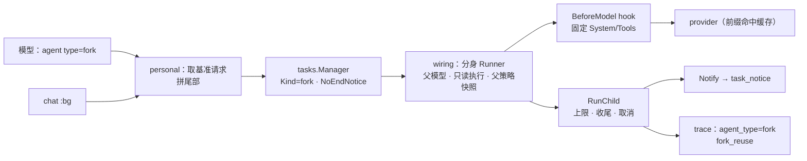

<!-- template_id: design; template_version: 1.2.0 -->
# suga 后台分身（fork）设计

> 状态：Draft 0.2 / 待人工计划批准

## 修订记录

| 版本 | 日期 | 作者 | 摘要 |
|---|---|---|---|
| 0.1 | 2026-11-26 | Claude | 初稿：依据 suga-hao6 与只读调研，定分身的触发面、上下文快照（沿用主循环请求前缀）、只读执行、回交与观测，列出待确认 Q1–Q5 |
| 0.2 | 2026-11-26 | Claude | 用户 2026-11-26：“hao6 Q1–Q5 按推荐”。Q1–Q5 转为决策 D1–D5（模型与 `:bg` 双入口、`agent` 的 `type: fork`、只读白名单、≤4000 字符带全文、共用现有上限）；删去未选方案的内容与赘述 |

> 仅语义变化递增版本；纯 identity/provenance/元数据纠正沿用原版本，并在 Git/进度记录中留痕。

## 设计工作声明

- 思考模式：`RIGOROUS`（SR1408）。
- 核心目标：主会话能派出一个“分身”在后台做子任务。分身带着主会话此刻的全部上下文起步，沿用主会话的请求前缀命中缓存；中间过程不进主会话，只回交结论。
- Scope freeze：只做只读分身：触发入口、上下文快照、执行与权限、回交、trace 与 `:tasks`。
- 暴露度：**Full**（依据见“安全、数据、运维与回滚”第 1 条）。
- Review budget：按 SR1409 Full 档做两轴独立评审，轮次按 `planning-core-rigorous` 执行；评审只看核心选择与 `CORE_BLOCKING`，不展开相邻架构。
- 停止条件：评审无开放 `CORE_BLOCKING`，交用户批准进入计划。

## 背景与目标

issue suga-hao6（用户 2026-11-07 的想法；2026-11-26：“hao6 出设计”）：派生一个继承当前会话全部对话上下文的后台 agent 去做子任务。

1. 普通子 agent（`agent` 工具）从零探索、重复读文件，起步成本高；分身已经知道主会话读过什么、在做什么。
2. 分身的工具输出与中间过程不进主会话，只回交结论。

用户可见结果：

- 模型调用工具或用户输入 `:bg <任务>` 派出分身后，主会话立刻可以继续；分身在 `:tasks` 里是一项后台任务，可以 kill。
- 分身结束时，主会话收到带结论的通知；chat 空闲时被唤醒继续（沿用 `tasks.wake_on_exit`）。
- 分身的第一次请求命中主会话已缓存的前缀，`suga inspect trace --json` 能看到缓存命中与 `fork_reuse` 结果。
- 分身用量计入主会话累计；trace 能从主会话跳到分身会话。

## 名词

- **分身（fork）**：起步上下文是主会话此刻请求的一次后台子 agent 运行。与 chat 的 `:fork N`（复制历史到新会话供人续聊）不同。
- **基准请求**：主会话最近一次主循环请求（`prefixTracker.lastRequest`，System、Tools、Messages 原样）。
- **分身请求**：基准请求加“尾部”：模型触发时是含分身调用的 assistant 消息与对应工具结果（任务指令）；`:bg` 触发时是上一轮最终回复加一条 user 指令。
- **前缀沿用**：分身请求的 System、Tools 与基准 Messages 逐字节不变，只在末尾追加；与交接包沿用前缀（`docs/design/2026-10-27-handoff-prefix-reuse-design.md`）同一做法。

## 范围与非目标

范围（仅 suga 仓库）：

- `agent` 工具新增 `type: fork`，只以后台方式运行；chat 命令 `:bg <任务>`；
- personal 层：取基准请求、拼尾部、固定请求头；wiring 层：分身 Runner 装配（父模型、只读执行）；
- 回交通知、trace attrs、`:tasks` 显示；
- 单测、GR110 分发测试、ptye2e、Windows 主机验证、一次真实模型缓存实测。

非目标：分身写文件、执行 shell 或上网；续聊分身会话；分身再派分身或子 agent；分身换模型（那就是现有 `agent` 工具）；进程退出后存活、ACP 回合外推送、gofer 新契约；同步分身。

受影响项目：只有 suga。gofer 经 `-a suga` 接入时分身是普通后台任务，`run` 结束前的收尾提醒照常生效。

## 已确认事实与规范

以代码为准（2026-11-26，HEAD `bc0e9ca5`）：

- **子 agent**：`pkg/agentcore/tools/native/agent.go` 的 `AgentTool` 只做参数、结果与元信息（`ReadOnly`）；`background: true` 时作为 `tasks.Spec{Kind:"agent", NoEndNotice:true}` 运行，结束时 `Notify` 报告前 12 行加用量 footer，全文在 task output。`internal/personal/subagent.go` 的 `RunChild` 建子会话（meta `kind=agent`、`parent_session_id`、`parent_turn_id`、`parent_call_id`、`agent_type`），处理软截止、收尾与取消；用量经 `SumUsageTree` 计入父会话。
- **子 Runner 装配**：`internal/wiring/subagent.go` 每次自建 store 句柄与 provider（共享 `llm.Pool` 的观察者会被替换），只注册白名单只读工具，审批取父策略快照，询问类失败关闭，外部来源守卫按“无人可问”运行；后台且子会话被污染时标记父会话。子 Runner 有自己的系统提示词与工具表，不沿用主会话前缀。
- **主循环请求可原样取回**：`prefixTracker.observeRequest` 保存每次主循环请求（发出后不再修改，host hook 已作用），`lastRequest` 取回，段断点时 `clearRequest`（`internal/personal/prefix.go:341-372`）。
- **前缀沿用的先例与教训**：交接包沿用调用 Tools 照常声明、不发 `ToolChoice`——实测 `tool_choice: none` 让网关丢掉工具定义、缓存不命中（`segment_handoff_reuse.go:118-131`，H5）。无进程内基准请求时可按持久化视图重建（`requestBaseBetweenTurns`），有 host hook 时不可重建。段内前缀复用率实测 100%（suga-jh7b）。
- **请求头可由 hook 固定**：agentcore 把 `BeforeModel` 的 `event.Request` 原样发给 provider（`pkg/agentcore/runtime.go:376-402`），不需要改 agentcore。
- **任务管理**：`pkg/agentcore/tasks` 按会话登记，`max_running` 默认 4（shell、agent 共用），`Kill` 取消函数任务 ctx；结束通知作为 `task_notice` 落库并在下一次请求前追加；chat 空闲按 `tasks.wake_on_exit` 唤醒；`run` 最终答复前提醒一次，之后终止仍在运行的任务；ACP 通知进下一个 prompt。chat 已有 `:tasks [-a|-k <ID>]`。
- **会话分叉**：`Runner.Fork`（`internal/personal/fork.go`，rewind/fork 设计 R6）复制可见历史供人续聊，不是后台执行。
- **适用规范**：SR1107、SR1403、SR1409、SR1410、GR104、GR108、GR109、GR110、SR2002；AGENTS.md“验证”一节。

## 总体方案

分身 = 现有后台子 agent 的执行与回交 + 以主会话基准请求为起点的请求头。

1. **触发**（D1、D2）：模型调用 `agent` 工具 `type: fork`，或用户在 chat 输入 `:bg <任务>`。只在挂了任务管理器时可用，总是后台运行（忽略 `background`）。
2. **快照**：不复制 transcript、不改投影。取进程内基准请求，拼上尾部：
   - 模型触发：尾部是那条 assistant 消息与每个调用的结果。分身调用的结果写任务指令（“你是分身……”加 prompt）；同一回复里的其他调用写占位“（未在分身中执行）”，保证成对。基准请求此时必然存在。
   - `:bg` 触发：尾部是上一轮最终回复加一条 user 指令。无进程内基准请求时按 `requestBaseBetweenTurns` 重建；重建不了就按持久化历史正常组装（上下文完整，只是不沿用缓存），记录原因。
3. **请求头固定**：分身 Runner 挂 `BeforeModel` hook，把每次请求的 System、Tools 换成基准值，Messages 为分身请求加分身新增消息；不发 `ToolChoice`。
4. **执行**：复用 `RunChild` 与子 agent 工厂（自建 store 与 provider、父策略快照、`agents.*` 上限、收尾与软截止）。差别三处：
   - 模型与 provider 配置取主会话本次使用的，不看 `agents.model`；
   - 模型看到基准请求里的全部工具（为了前缀），执行层只放行 explore 白名单（D3），其余调用返回“分身只读，需要改动请写进报告”；`agent`、`task`、`tool_search` 一律拒绝；
   - 不做段断点或压缩，超过阈值即收尾（`stop=context`）。
5. **回交**（D4）：沿用后台 agent 的 `Notify` 路径；报告不超过 4000 字符时通知带全文，超过时带前 12 行并注明截断；全文在 `task output`。通知作为 `task_notice` 进入主会话上下文。
6. **观测**：分身会话 `kind=agent`、`agent_type=fork`；新增 meta `fork_base`（主会话 id、基准请求所在 turn、尾部来源）与 model 事件 attr `fork_reuse=prefix|fallback:<reason>`；任务 `Kind=fork`。

## 架构

代码组织（参照 suga 现有子 agent 分层，依赖方向 chat → personal → store，wiring 只装配，GR108）：

- `pkg/agentcore/tools/native/agent.go`：`type: fork` 的参数、描述（补一句“fork 带着本对话全部上下文”）与结果格式；不依赖 internal。
- `internal/personal/subagent_fork.go`（新）：基准请求、尾部、固定请求头的 hook、回退原因常量。
- `internal/wiring/subagent.go`：分身装配分支；接近 GR104 上限时拆到 `subagent_fork.go`。
- `internal/chat/chat_fork_bg.go`（新）：`:bg` 命令，只调 personal 层。
- 不新增 CLI 子命令；`suga run` 与 ACP 经模型工具触发。

## 关键流程

### 1. 模型触发（chat / run / ACP 相同）

1. 模型调用 `agent`（`type: fork`、`description`、`prompt`）。
2. 工具取基准请求与本条 assistant 消息拼出分身首个请求，启动 `Kind=fork` 任务，立即返回 `[background fork task t2 started: <description>]`。
3. 分身后台运行，主回合继续；`:tasks` 列出它。
4. 结束：通知进入主会话下一次请求；chat 空闲则唤醒注入回合；`run` 沿用“提醒一次、之后终止并注明”。

### 2. `:bg <任务>`（仅 chat）

回合进行中输入时放回输入行，下一个提示符执行（同 `:rewind`）；以上一轮结束时的基准请求为起点（或重建/回退），启动同一种任务，之后同流程 1 第 3–4 步。

### 3. kill 与失败

- `:tasks -k t2` 或 `task kill t2`：取消分身 ctx，`stop=cancelled`，task output 写最后一段回答，通知写“分身被终止”。
- 主回合 Ctrl-C 不影响后台分身；chat 退出、ACP 连接关闭、`run` 结束时随任务管理器终止。
- `agents.max_steps` / `max_tokens` / `timeout` 与上下文阈值都走收尾，报告首行写明原因。

## 安全、数据、运维与回滚

1. **暴露度：Full**。不满足 SR1409“本机工具档”：
   - 发布渠道对外：`origin` 为公开仓库 `github.com/inhere/suga`，推 `v*` tag 经 `.github/workflows/release.yml` 发布三平台构建（最新 `v0.56.2`）；README 给出 `eget install inhere/suga`、`go install github.com/inhere/suga/cmd/suga@latest`、GitHub Releases 三种安装方式，属于对外宣传；无“没有外部用户”的依据（容器内 `gh` 未登录），按不明处理。
   - 新增无人值守执行路径：分身以主会话审批策略快照在后台执行工具，属于权限面变化，按规定走 Full。
   - 其余满足：revert 可恢复；不迁移持久数据（只新增 meta 键与 attr）；不新增 Secret 处理；不新增出机器的目的地（只向主会话已在用的 provider 发请求）。
2. **权限**：执行层白名单 + 父策略快照 + 询问失败关闭 + 外部来源守卫 + 危险删除守卫，全部沿用子 agent 现有实现。对模型声明全部工具只为前缀一致，不代表可执行。
3. **数据**：分身会话只落自己新增的 entries 与 events，快照在内存里；主会话已被污染时分身会话起步即标记污染；分身读了外部内容时按后台 agent 路径标记主会话。
4. **文件冲突**：分身不写文件；主会话可能在分身读取期间改文件，指令要求报告列出依据的文件:行号供主会话复核，不做锁。
5. **费用**：每个分身首个请求是主会话整段上下文，命中缓存按缓存价，未命中（回退、缓存过期）为全价；并发受共用的 `max_running` 限制（D5）；用量计入主会话，gofer 预算照常生效。
6. **回滚**：revert 即可；旧版本把分身会话当普通子 agent 会话，未知 meta 与 attr 被忽略。

## 决策

| # | 决策 | 依据 |
|---|---|---|
| D1 | 模型工具与 chat 命令 `:bg <任务>` 都能触发；`run` 与 ACP 只经模型触发；不用 `:fork`（已被会话分叉占用） | 用户 2026-11-26：“hao6 Q1–Q5 按推荐”（Q1 推荐 C） |
| D2 | 用 `agent` 工具的 `type: fork`，不新建工具 | 同上（Q2 推荐 A）：少一个工具定义，任务、通知、trace 同一路径 |
| D3 | 分身只读，沿用 explore 白名单（file_read/list/grep/find/symbols/refs），不能写、不能 shell、不能上网 | 同上（Q3 推荐 A）：权限面与已批准的后台子 agent 一致，无写冲突 |
| D4 | 报告不超过 4000 字符时通知带全文，超过时带前 12 行并注明截断 | 同上（Q4 推荐 B）：省掉几乎必然的一次 `task output` |
| D5 | 与 shell、agent 共用 `tasks.max_running`（默认 4），沿用 `agents.max_steps` / `max_tokens` / `timeout`，不加新配置 | 同上（Q5 推荐 A）：`max_tokens` 只算未命中缓存部分；实测异常再加（SR1405） |
| F1 | 快照用进程内基准请求加尾部，不复制 transcript、不改投影与 `loadHistory` | 改投影要过 rewind 设计列出的全部读者，代价远大于收益（SR1410） |
| F2 | 分身 Runner 的 `BeforeModel` hook 把请求头固定为基准 System/Tools，不发 `ToolChoice` | 运行时发送 hook 后的请求；H5 实测 `tool_choice` 破坏前缀 |
| F3 | 分身固定用主会话的模型与 provider 配置，自建 provider 实例 | 换模型没有共享缓存；共享 Pool 会被替换观察者 |
| F4 | 执行、上限、收尾、取消、用量、污染传递、子会话过滤复用 `RunChild` 与后台 agent 路径；会话 `kind=agent`、`agent_type=fork` | 不重复实现（SR1403） |
| F5 | 分身总是后台运行，不提供同步分身 | 同步等待与普通子 agent 无差别 |
| F6 | 分身不做段断点或压缩，超过阈值即收尾（`stop=context`） | 段断点会丢前缀；分身是一次性的 |
| F7 | 无基准请求时先重建，重建不了按持久化历史组装，记 `fork_reuse=fallback:<reason>` | 上下文完整优先于缓存；原因可在 trace 统计 |
| F8 | 与 `:fork N` 不共享实现 | 前者复制历史供人续聊，分身是一次性后台执行 |

## 待确认事项

无。用户 2026-11-26：“hao6 Q1–Q5 按推荐”。选项记录：

- Q1 触发面：A 只给模型；B 只给用户命令；**C 两者都有（选中，D1）**。
- Q2 工具形态：**A `agent` 工具 `type: fork`（选中，D2）**；B 新工具 `fork`。
- Q3 执行权限：**A 只读 explore 白名单（选中，D3）**；B 加放行无需询问的 shell；C 独立 worktree 中可写。
- Q4 回交内容：A 只带前 12 行；**B ≤4000 字符带全文，超过截断（选中，D4）**。
- Q5 并发与预算：**A 共用现有上限（选中，D5）**；B 另设分身专用配置。

## 结论与人工计划 Gate

方案：分身复用后台子 agent 的执行、权限、回交与观测，只新增“以主会话基准请求为起点、固定请求头”这一层，使分身带全部上下文起步并命中主会话缓存，过程不进主会话。

验证要求（写入计划的验收）：

- **单测**：分身首个请求的 System/Tools/Messages 前缀与基准请求逐字节相同（录请求的假 provider）；其他调用的占位结果成对；写工具、shell、`agent`、`task`、`tool_search` 被拒并返回分身提示；各回退原因；kill 后 `stop=cancelled`；D4 截断规则。
- **GR110**：经 `app.Run([]string{"run", ...})`，假模型触发分身并 `task wait`，断言输出与 `inspect trace --json` 中的分身子会话。
- **ptye2e**（`test/ptye2e`，`-tags ptye2e`，加入 `make smoke-go`）：假模型派分身 → 启动行 → `:tasks` 显示 → 空闲时通知唤醒注入回合；`:bg` 触发；`:tasks -k` 终止。结束后 `suga inspect trace --json` 断言：`agent_type=fork`、`fork_reuse=prefix`、分身首个请求以主会话最后一次请求的消息为前缀、主会话有 `task_notice`。
- **反向验证**：临时让分身按普通子 agent 方式组装请求，确认前缀断言失败；临时去掉执行白名单，确认“写工具被拒”断言失败；确认失败来自断言而非编译失败。
- **Windows**：经 gofer exec job 在主机跑 `go test ./...` 与 ptye2e（ConPTY）。
- **真实模型**：一个真实 provider 跑一轮带分身的多步对话，记录分身首个请求的 `cache_read / prompt`，目标不低于段内复用水平，达不到时写明原因。

人工计划 Gate：按 Full 做两轴独立评审，无开放 `CORE_BLOCKING` 后交用户批准进入计划。设计批准只授权写计划，不授权实施。
