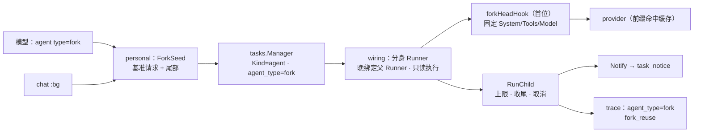

<!-- template_id: design; template_version: 1.2.0 -->
# suga 后台分身（fork）设计

> 状态：Draft 0.5 / 已批准进入计划（0.4 批准；0.5 仅含 Q3 修正）；issue `suga-hao6`

## 修订记录

| 版本 | 日期 | 作者 | 摘要 |
|---|---|---|---|
| 0.1 | 2026-11-26 | Claude | 初稿：依据 suga-hao6 与只读调研，定分身的触发面、上下文快照（沿用主循环请求前缀）、只读执行、回交与观测，列出待确认 Q1–Q5 |
| 0.2 | 2026-11-26 | Claude | 用户 2026-11-26：“hao6 Q1–Q5 按推荐”。Q1–Q5 转为决策 D1–D5（模型与 `:bg` 双入口、`agent` 的 `type: fork`、只读白名单、≤4000 字符带全文、共用现有上限）；删去未选方案的内容与赘述 |
| 0.3 | 2026-11-26 | Claude | 处理两轴第 1 轮评审（`docs/review/2026-11-26-background-fork/`），见下表 |
| 0.4 | 2026-11-26 | Claude | 未复核修订（第 2 轮之后）：第 2 轮两轴 PASS，处理剩余纠正项 BF11–BF14、BS3–BS5，见第 2 轮处理表 |
| 0.5 | 2026-11-26 | Claude | kill 不通知，沿用 6gcy；用户 Q3 选 A（计划评审 PF4/PS1/PS6）：关键流程 3 改为不通知、output 写“已终止”、`stop=cancelled`；用户直接决定，未另行评审 |

> Q3：终止分身后是否通知主会话。A（推荐）沿用 6gcy，不通知：与普通后台 agent 一致；B 只对分身发通知。用户 2026-11-26：“hao6 Q3 选 A”。

第 1 轮处理：

| 发现 | 处理 |
|---|---|
| BF1（阻断） | 分身的拒绝返回普通错误结果，不计入每回合拒绝上限；提示按基准 Tools 统一生成（F9）；验收加“连续 3 次写调用后仍有结论” |
| BS1、BF7 | 任务保持 `Kind:"agent"`、摘要 `agent: ` 前缀，只用 `agent_type=fork` 与 `fork_reuse` 区分；`fork_base` 去掉与 `parent_session_id` 重复的字段 |
| BS2、BF8 | D4 只作用于 `type: fork`，实现在 `startBackground`，按 rune 计、不含 footer；满额直接拒绝并给两种提示；`:bg` 进命令分发与放回名单、带会话 ctx、空参提示 |
| BF2 | 尾部来源与展开规则写定（F10），排在前面的调用填真实结果 |
| BF3 | 分身关闭折叠、段断点与截断，按上次调用实测输入计量，新增 `stop=context`（F6） |
| BF4 | 请求头 hook 规格写定（F2） |
| BF5 | “可用基准”与各情形的处理写成表；重建不了就拒绝启动，不再有第三种请求头（F7） |
| BF6 | 晚绑定父 Runner，模型取父 Runner 当前值（F3） |
| BF9 | 前缀断言改用 `fakeLLM.Requests()`；`fork_reuse` 只记首个 model 事件；每项补用例；真实模型改为记录命中率供对比；0.3 误删了“去掉执行白名单”的反向验证，0.4 恢复（BS5） |
| BF10 | 记为 deferred |

第 2 轮处理（未复核）：

| 发现 | 处理 |
|---|---|
| BF11、BS3 | `:compact`、`:rewind`、段断点、段清理之后照常用重建结果启动，跳过 `prefix_changed` 判定，记 `rebuilt`；只有 host hook 与 `prompt_state` 拒绝；验收每种情形写唯一期望（F7） |
| BF12 | 按身份去掉 RunChild 的 Prompt；分身模式不渲染子会话的段上下文、hookContext、ephemeral（F2） |
| BF13 | “不发 `ToolChoice`”只适用于常规步，收尾重试保留运行时设定（F2） |
| BF14 | 分身中的一切拒绝（含 ask 规则在无终端时失败关闭）都返回普通错误结果（F9），补 ask 规则用例 |
| BS5 | 恢复白名单反向验证；“连续 3 次写调用”断言 F9 提示与目标文件未被创建或修改 |
| BS4 | Gate 一节附用户选择之外的用户可见差异 |

> 仅语义变化递增版本；纯 identity/provenance/元数据纠正沿用原版本，并在 Git/进度记录中留痕。

## 设计工作声明

- 思考模式：`RIGOROUS`（SR1408）。
- 核心目标：主会话能派出一个“分身”在后台做子任务。分身带着主会话此刻的全部上下文起步，沿用主会话的请求前缀命中缓存；中间过程不进主会话，只回交结论。
- Scope freeze：只做只读分身：触发入口、上下文快照、执行与权限、回交、trace 与 `:tasks`。
- 暴露度：**Full**（依据见“安全、数据、运维与回滚”第 1 条）。
- Review budget：按 SR1409 Full 档做两轴独立评审，轮次按 `planning-core-rigorous` 执行；评审只看核心选择与 `CORE_BLOCKING`。
- 停止条件：评审无开放 `CORE_BLOCKING`，交用户批准进入计划。

## 背景与目标

issue suga-hao6（用户 2026-11-07 的想法；2026-11-26：“hao6 出设计”）：派生一个继承当前会话全部对话上下文的后台 agent 去做子任务。

1. 普通子 agent（`agent` 工具）从零探索、重复读文件，起步成本高；分身已经知道主会话读过什么、在做什么。
2. 分身的工具输出与中间过程不进主会话，只回交结论。

用户可见结果：

- 模型调用工具或用户输入 `:bg <任务>` 派出分身后，主会话立刻可以继续；分身在 `:tasks` 和状态行里是一项后台 agent 任务，可以 kill。
- 分身结束时，主会话收到带结论的通知；chat 空闲时被唤醒继续（沿用 `tasks.wake_on_exit`）。
- 分身的第一次请求沿用主会话的请求前缀，`suga inspect trace --json` 能看到缓存命中与 `fork_reuse`。
- 分身用量计入主会话累计；trace 能从主会话跳到分身会话。

## 名词

- **分身（fork）**：起步上下文是主会话此刻请求的一次后台子 agent 运行。与 chat 的 `:fork N`（复制历史到新会话供人续聊）不同。
- **基准请求**：主会话最近一次主循环请求（`prefixTracker.lastRequest`，System、Tools、Messages 原样）。
- **尾部**：接在基准请求之后的消息。模型触发时是产生分身调用的那一步回复（展开为逐调用 assistant 消息）及各调用结果；`:bg` 触发时是上一轮最终回复加一条 user 指令。
- **前缀沿用**：分身请求的 System、Tools 与基准 Messages 逐字节不变，只在末尾追加；与交接包沿用前缀（`docs/design/2026-10-27-handoff-prefix-reuse-design.md`）同一做法。

## 范围与非目标

范围（仅 suga 仓库）：

- `agent` 工具新增 `type: fork`，只以后台方式运行；chat 命令 `:bg <任务>`；
- personal 层：记录当步回复与已执行结果、产出分身种子（基准请求加尾部）、固定请求头的 hook、分身模式的上下文计量；
- wiring 层：分身 Runner 装配（晚绑定父 Runner、只读执行、统一拒绝提示）；
- 回交通知、trace attrs；
- 单测、GR110 分发测试、ptye2e、Windows 主机验证、一次真实模型缓存记录。

非目标：分身写文件、执行 shell 或上网；续聊分身会话；分身再派分身或子 agent；分身换模型（那就是现有 `agent` 工具）；进程退出后存活、ACP 回合外推送、gofer 新契约；同步分身。

deferred：分身白名单不含 `recall`，读不到主会话上下文里的 spill ref，只能重读文件（BF10）；拒绝提示里说明这一点，实测有需要再评估加入（`recall` 会标记污染）。

受影响项目：只有 suga。gofer 经 `-a suga` 接入时分身是普通后台任务，`run` 结束前的收尾提醒照常生效。

## 已确认事实与规范

以代码为准（2026-11-26，HEAD `bc0e9ca5`；评审核对到 `dd7b5fd8`）：

- **子 agent**：`AgentTool`（`pkg/agentcore/tools/native/agent.go`）只做参数、结果与元信息；`background: true` 时 `startBackground` 以 `tasks.Spec{Kind:"agent", Summary:"agent: …", NoEndNotice:true}` 运行，结束 `Notify` 前 12 行（`agentNoticeLines`）加 footer，全文在 task output。`RunChild`（`internal/personal/subagent.go`）建子会话（meta `kind=agent`、`parent_session_id`、`parent_turn_id`、`parent_call_id`、`agent_type`），处理软截止、收尾与取消；用量经 `SumUsageTree` 计入父会话。
- **按 `Kind=="agent"` 工作的消费方**：`internal/chat/render_agents.go:62,226`（状态行计数、完成摘要，要求 `agent: ` 前缀）、`internal/personal/trace.go:435,467`、`internal/personal/analyze.go:244`。
- **子 Runner 装配**：`internal/wiring/subagent.go` 在 `personal.New` 之前构造（`runtime.go:550-560`），只持有启动时的 `mainModel`；每次自建 store 与 provider，只注册白名单只读工具，审批取父策略快照，询问类失败关闭。`:model` 走 `Runner.SwitchModel`，不更新 `subAgents`。`memoryHost` 是在 `personal.New` 之后晚绑定的先例。
- **拒绝路径**：子 agent 的禁用提示 `SetDisabled` 返回 `tools.Denied`，套模板“……不要重试，请告诉用户开启方法”；每个 `ErrDenied` 计入每回合拒绝数（`observe.go:316-319`），满 `DenialLimit=3` 时 `denialLimitHook` 用“……等待授权”短路回合（`denial.go:99-111`），`RunChild` 会把它当 final 报告。不在 Catalog 的名字走 not-found 普通错误（`approval.go:142`）。
- **请求与回复**：`prefixTracker` 只存请求（`prefix.go:341-372`），段断点、`:compact`、`:rewind`、段清理调用 `clearRequest`（`compact.go:413`、`rewind.go:254`、`segment_clear.go:129`），取消或失败的回合不清。运行时逐调用执行与落库；assistant 按“每调用一条消息”保存，lead 文字、`Reasoning` 与 provider 元数据（签名 thinking）只在第一条，并行批次带 `ToolBatchMetaKey`（`runtime.go:487-495,518-533,622-640`）。`AgentTool.Execute` 只拿到 `api.ToolCall`。
- **前缀沿用的先例**：交接包沿用调用 Tools 照常声明、不发 `ToolChoice`（H5 实测 `tool_choice: none` 让网关丢掉工具定义）；`requestBaseBetweenTurns` 可按持久化视图重建，host hook、`prompt_state`、`prefix_changed` 的判定在 `prepareHandoffReuse`（`segment_handoff_reuse.go:90-131,206-227`）。
- **hook 与上下文管线**：`BeforeModel` 的 `event.Request` 原样发出（`pkg/agentcore/runtime.go:376-402`）；hook 顺序 prefixHook → deadlineHook → `cfg.Hooks` → limitHook → … → handoffRequestHook（`runner.go:806-835`）。`contextBuilder` 超阈值时折叠、段断点或 shrink 截断，`estimate` 用上次调用上报的输入加增量（`context.go:497-535`）。
- **任务管理**：`Manager.Start` 满 `MaxRunning`（默认 4）直接报错、不排队（`tasks.go:281-284`），会话取自 `api.SessionIDFrom(ctx)`；通知原样进 `TaskNoticeText`（`internal/personal/tasks.go:66-88`）；chat 空闲按 `tasks.wake_on_exit` 唤醒；`run` 最终答复前提醒一次后终止；ACP 通知进下一个 prompt。chat 命令分发在 `chat.go:682`，回合中放回输入行的名单在 `steering.go:209`。
- **测试设施**：trace 的 model 事件只有 `prefix_*` 统计与 token，没有正文；`fakeLLM.Requests()` 记录请求全文（`test/ptye2e/fakellm_test.go:187-191`）。
- **适用规范**：SR1107、SR1403、SR1409、SR1410、GR104、GR108、GR109、GR110、SR2002；AGENTS.md“验证”一节。

## 总体方案

分身 = 现有后台子 agent 的执行与回交 + 以主会话基准请求为起点的请求头。

1. **触发**（D1、D2）：模型调用 `agent` 工具 `type: fork`，或用户在 chat 输入 `:bg <任务>`。只在挂了任务管理器时可用，总是后台运行。
2. **种子**：personal 暴露 `Runner.ForkSeed`，返回基准请求与尾部的副本、当前模型与 provider 名、`fork_reuse`。来源与规则见 F7、F10；拿不到可用基准时返回原因，分身不启动。
3. **请求头固定**：见 F2。
4. **执行**：复用 `RunChild` 与子 agent 工厂（自建 store 与 provider、父策略快照、`agents.*` 上限、收尾与软截止）。不同之处：模型取自种子（F3）；拒绝规则见 F9；上下文计量见 F6。
5. **回交**（D4）：`startBackground` 中 `type: fork` 分支：报告正文（不含 footer）不超过 4000 rune 时通知带全文，超过时带前 12 行并注明截断；footer 照常附上。普通后台 agent 不变。分身指令要求报告不超过 4000 字符（分身沿用主会话 System，子 agent 提示词的长度要求对它不生效）。
6. **观测**：任务 `Kind:"agent"`、摘要 `agent: <description>`，task label 与会话 meta `agent_type=fork`；会话 meta `fork_base`（基准请求所在 turn、尾部来源 `call|bg`）；分身首个 model 事件带 attr `fork_reuse=prefix|rebuilt`。现有状态行、完成摘要、trace 任务行、`--analyze` 自动覆盖分身。

## 架构

代码组织（参照 suga 现有子 agent 分层，依赖方向 chat → personal → store，wiring 只装配，GR108）：

- `pkg/agentcore/tools/native/agent.go`：`type: fork` 的参数、描述（补一句“fork 带着本对话全部上下文”）、`startBackground` 的 D4 分支、`Stop` 取值说明加 `context`。不依赖 internal。
- `internal/personal/subagent_fork.go`（新）：当步回复与已执行结果的记录、`ForkSeed`、`forkHeadHook`、分身上下文计量、`fork_reuse` 与拒绝原因常量。
- `internal/wiring/subagent.go`：`forkHost` 晚绑定与分身装配分支（拒绝提示表）；接近 GR104 上限时拆到 `subagent_fork.go`。
- `internal/chat/chat_fork_bg.go`（新）：`:bg` 命令，只调 personal 层；`chat.go` 分发与 `steering.go` 放回名单各加一项。
- 不新增 CLI 子命令；`suga run` 与 ACP 经模型工具触发。

## 关键流程

### 1. 模型触发（chat / run / ACP 相同）

1. 模型调用 `agent`（`type: fork`、`description`、`prompt`）。
2. 工具经 `ForkSeed` 取当步基准请求与尾部（F10），启动任务，立即返回 `[background fork task t2 started: <description>]`。满额时返回工具错误：“已有 N 个后台任务在运行（上限 N），先 task wait 或 task kill 再派分身”。
3. 分身后台运行，主回合继续；`:tasks` 与状态行列出它。
4. 结束：通知进入主会话下一次请求；chat 空闲则唤醒注入回合；`run` 沿用“提醒一次、之后终止并注明”。

### 2. `:bg <任务>`（仅 chat）

1. 回合进行中输入时放回输入行，下一个提示符执行；不带参数打印“用法：:bg <任务>”。
2. 以 `api.WithSessionID(ctx, 当前会话)` 调 `ForkSeed` 并启动任务；拿不到可用基准时打印原因（见 F7），满额时打印“后台任务已满（N/N），用 :tasks 查看或 :tasks -k <ID> 终止后重试”。
3. 之后同流程 1 第 3–4 步。

### 3. kill 与失败

- `:tasks -k t2` 或 `task kill t2`：取消分身 ctx，`stop=cancelled`，task output 写“已终止”，不发通知（沿用 6gcy 的现有 kill 行为，避免唤醒没人要的回合）。
- 主回合 Ctrl-C 不影响后台分身；chat 退出、ACP 连接关闭、`run` 结束时随任务管理器终止。
- `agents.max_steps` / `max_tokens` / `timeout` 与上下文阈值（`stop=context`）都走收尾，报告首行写明原因。

## 安全、数据、运维与回滚

1. **暴露度：Full**。不满足 SR1409“本机工具档”：
   - 发布渠道对外：`origin` 为公开仓库 `github.com/inhere/suga`，推 `v*` tag 经 `.github/workflows/release.yml` 发布三平台构建；README 给出 `eget install inhere/suga`、`go install github.com/inhere/suga/cmd/suga@latest`、GitHub Releases 三种安装方式，属于对外宣传；无“没有外部用户”的依据（容器内 `gh` 未登录），按不明处理。
   - 分身以主会话审批策略快照在后台执行工具。执行白名单与已有后台 explore 子 agent 相同，但模型可见的工具面是主会话全部工具，拒绝路径是新的。
   - 其余满足：revert 可恢复；不迁移持久数据（只新增 meta 键与 attr）；不新增 Secret 处理；不新增出机器的目的地。
2. **权限**：执行层白名单 + 父策略快照 + 询问失败关闭 + 外部来源守卫 + 危险删除守卫，沿用子 agent 实现。对模型声明全部工具只为前缀一致，不代表可执行。
3. **数据**：分身会话只落自己新增的 entries 与 events，种子在内存里；主会话已被污染时分身会话起步即标记污染；分身读了外部内容时按后台 agent 路径标记主会话。
4. **文件冲突**：分身不写文件；主会话可能在分身读取期间改文件，指令要求报告列出依据的文件:行号供主会话复核，不做锁。
5. **费用**：分身首个请求是主会话整段上下文，命中按缓存价，未命中（重建后前缀不同、缓存过期）为全价；并发受共用的 `max_running` 限制；用量计入主会话，gofer 预算照常生效。
6. **回滚**：revert 即可；旧版本把分身会话当普通子 agent 会话，未知 meta 与 attr 被忽略。

## 决策

| # | 决策 | 依据 |
|---|---|---|
| D1 | 模型工具与 chat 命令 `:bg <任务>` 都能触发；`run` 与 ACP 只经模型触发；不用 `:fork`（已被会话分叉占用） | 用户 2026-11-26：“hao6 Q1–Q5 按推荐”（Q1 推荐 C） |
| D2 | 用 `agent` 工具的 `type: fork`，不新建工具 | 同上（Q2 推荐 A） |
| D3 | 分身只读，沿用 explore 白名单（file_read/list/grep/find/symbols/refs），不能写、不能 shell、不能上网 | 同上（Q3 推荐 A） |
| D4 | 仅 `type: fork`：报告正文 ≤4000 rune（不含 footer）时通知带全文，超过时前 12 行并注明截断；普通后台 agent 不变 | 同上（Q4 推荐 B）；BS2、BF8 |
| D5 | 与 shell、agent 共用 `tasks.max_running`（默认 4）与 `agents.max_steps` / `max_tokens` / `timeout`；满额直接拒绝、不排队 | 同上（Q5 推荐 A）；BF8 |
| F1 | 种子用进程内基准请求加尾部，不复制 transcript、不改投影与 `loadHistory` | 改投影要过 rewind 设计列出的全部读者（SR1410） |
| F2 | `forkHeadHook` 挂在分身 Runner hook 链首位（prefixHook 之前，所以前缀统计与 handoffRequestHook 看到的都是改写后的请求）。输出：System、Tools、Model 取种子；Messages 为新分配的切片 = 基准 Messages + 尾部 + 分身自己的消息（按身份去掉 RunChild 的 Prompt，指令已在尾部；分身模式不渲染子会话的段上下文、hookContext、ephemeral，基准里已有主会话的段上下文）；运行时追加的 wrap-up 与其后 deadlineHook 的提示按原顺序留在末尾；常规步不发 `ToolChoice`，收尾重试保留运行时设定的值（只有这一次不命中缓存）；不在共享切片上 append | BF4、BF12、BF13；H5 |
| F3 | `subAgents` 经 `forkHost` 在 `personal.New` 之后晚绑定父 Runner（同 `memoryHost`）；分身的模型与 provider 名取种子（父 Runner 当前值，`:model` 切换后即新模型），自建 provider 实例；wiring 不直接碰 tracker | BF6；共享 Pool 会被替换观察者 |
| F4 | 执行、上限、收尾、取消、用量、污染传递、子会话过滤复用 `RunChild` 与后台 agent 路径；任务 `Kind:"agent"`、摘要 `agent: ` 前缀，只用 `agent_type=fork` 与 `fork_reuse` 区分；`fork_base` 只存 turn 与尾部来源 | SR1403；BS1、BF7 |
| F5 | 分身总是后台运行，不提供同步分身 | 同步等待与普通子 agent 无差别 |
| F6 | 分身模式下 `contextBuilder` 不折叠、不段断点、不 shrink 截断；计量用上次调用 provider 上报的输入 token（即改写后的请求），达到主会话同一阈值（`window - reserve`）时 `RequestWrapUp(context)`；种子估算已超阈值时不启动，提示改用 `agent explore`。`ChildResult.Stop` / `AgentReport.Stop` 新增 `context` | BF3 |
| F7 | 可用基准与处理：模型触发总用当步请求（`prefix`）。`:bg` 时，上一回合正常完成、模型未变且 tracker 中请求属于该回合才直接用（`prefix`）；`--resume` 后未发请求、`:compact`、段断点、`:rewind`、段清理（已被清除）、上一回合取消或失败（请求不属已完成回合）、`:model` 切换后（按新模型）一律按 `requestBaseBetweenTurns` 重建并启动（`rebuilt`，请求头为主会话的 System/Tools），跳过与上回合指纹的 `prefix_changed` 比对（对分身它只意味着缓存不命中，原因附在 attr 上）；只有配置了 host hook 或 `prompt_state` 时重建内容不可信，分身不启动并提示原因（沿用 `handoffFallback*` 命名）。没有第三种请求头 | BF5、BF11；上下文完整优先于缓存 |
| F8 | 与 `:fork N` 不共享实现 | 前者复制历史供人续聊，分身是一次性后台执行 |
| F9 | 分身中的一切拒绝都返回普通错误结果（不是 `ErrDenied`，不计入每回合拒绝上限），包括 ask 规则在无终端时的失败关闭（在 Approval 外层转换）。基准 Tools 中每个不在白名单的名字（Catalog 内外、`agent`、`task`、`tool_search`、`tool_call` 代理、MCP、memory）统一提示：“分身只读：<名字> 在分身中不可用，不要重试；需要改动或命令时写进报告由主会话执行”；不用“告诉用户开启方法”。反复尝试由 `agents.max_steps` 收尾兜住 | BF1、BF14 |
| F10 | 尾部来源：personal 在主会话 turnHooks 中用 AfterModel 记下当步 `GenerateResult`、用 AfterTool 记下本批已执行的结果（下一步 AfterModel 时清空）。按 `persistToolTranscript` 的规则展开为逐调用 assistant 消息（lead 文字、reasoning、签名 thinking 元数据、批次 meta 原样）；排在分身调用之前的调用填真实结果，分身调用填任务指令，之后的调用填“主会话在派出分身后才执行此调用，分身中未执行” | BF2 |

## 待确认事项

无。用户 2026-11-26：“hao6 Q1–Q5 按推荐”。选项记录：

- Q1 触发面：A 只给模型；B 只给用户命令；**C 两者都有（选中，D1）**。
- Q2 工具形态：**A `agent` 工具 `type: fork`（选中，D2）**；B 新工具 `fork`。
- Q3 执行权限：**A 只读 explore 白名单（选中，D3）**；B 加放行无需询问的 shell；C 独立 worktree 中可写。
- Q4 回交内容：A 只带前 12 行；**B ≤4000 字符带全文，超过截断（选中，D4）**。
- Q5 并发与预算：**A 共用现有上限（选中，D5）**；B 另设分身专用配置。

## 结论与人工计划 Gate

方案：分身复用后台子 agent 的执行、权限、回交与观测，只新增“以主会话基准请求为起点、固定请求头”这一层，使分身带全部上下文起步并命中主会话缓存，过程不进主会话。

验证要求（写入计划的验收）：

- **单测**（录请求的假 provider）：
  - 前缀：分身首个请求的 System/Tools/Model 与基准相同，Messages 以基准 Messages 为前缀，基准切片未被修改（F1、F2）；
  - 尾部：带 reasoning 与签名元数据的回复、并行批次中排在分身前后的调用各自的结果（F10）；
  - 拒绝：连续 3 次写调用后作答，每次写调用返回 F9 提示、目标文件未被创建或修改、报告是作答内容、`stop=final`；ask 规则下连续 3 次读调用同样 `stop=final`；`agent`、`tool_call`、MCP 名字的提示文案一致（F9）；
  - 阈值：分身上下文达到阈值时 `stop=context` 且有报告，种子超阈值时不启动（F6）；
  - 基准：正常回合后 `prefix`；`--resume` 后、取消回合后、`:compact` 后、`:rewind` 后、`:model` 切换后均为 `rebuilt` 并启动；配置 host hook 时拒绝并提示 `host_hook`（F3、F7）；
  - 回交：分身报告 ≤4000 rune 全文、超过截断；普通后台 agent 通知不变（D4）；满额拒绝（D5）；kill 后 `stop=cancelled`。
- **GR110**：经 `app.Run([]string{"run", ...})`，假模型触发分身并 `task wait`，断言输出与 `inspect trace --json` 中的分身子会话。
- **ptye2e**（`test/ptye2e`，`-tags ptye2e`，加入 `make smoke-go`）：假模型派分身 → 启动行与状态行计数 → `:tasks` 显示 → 空闲时通知唤醒注入回合；`:bg` 触发、空参提示、回合中放回输入行；`:tasks -k` 终止。前缀用 `fakeLLM.Requests()` 逐字节断言；结束后 `suga inspect trace --json` 只断言分身子会话 `agent_type=fork`、首个 model 事件 `fork_reuse=prefix`、任务行显示步数、主会话有 `task_notice`。
- **反向验证**：临时让分身按普通子 agent 方式组装请求，确认前缀断言失败；临时把分身拒绝改回 `ErrDenied`，确认“连续 3 次写调用”用例失败；临时去掉执行白名单，确认“写调用返回 F9 提示、文件未改”断言失败；确认失败来自断言而非编译失败。
- **Windows**：经 gofer exec job 在主机跑 `go test ./...` 与 ptye2e（ConPTY）。
- **真实模型**：一个真实 provider 跑一轮带分身的多步对话，记录分身首个请求的 `cache_read / prompt` 与同会话主循环 steady 桶命中率，并列供对比，不设门槛。

与用户选择之外的用户可见差异（评审中新增，不需另做决策）：
- `:bg` 在配置了 host hook 或 `prompt_state` 时拒绝启动并提示原因；
- 种子估算超过上下文阈值时拒绝启动，提示改用 `agent explore`；
- 真实模型的缓存命中只记录供对比，不设验收门槛。

人工计划 Gate：两轴第 2 轮 PASS；0.4 为第 2 轮之后的未复核修订（BF11–BF14、BS3–BS5）。请用户批准 0.4 进入计划，或点名只按 0.3 批准。设计批准只授权写计划，不授权实施。

批准记录：2026-11-26 用户原话“批准 suga 后台分身设计 0.4（接受未复核修订），开始写计划”。批准范围：0.4（含第 2 轮之后的未复核修订）；授权进入计划，不授权实施。0.4 批准；0.5 仅含 Q3 修正（用户直接决定）。
